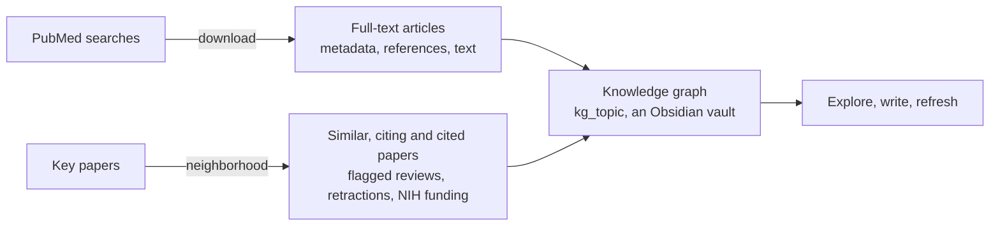
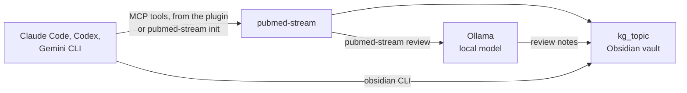
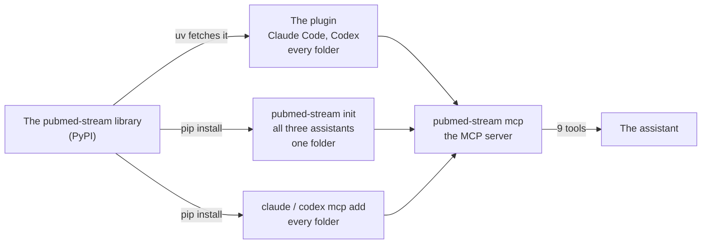

# pubmed-stream: literature searches in PubMed, for researchers and their AI assistants

[](https://pypi.org/project/pubmed-stream/)
[](https://www.python.org/downloads/)
[](https://opensource.org/licenses/MIT)
[](https://melhzy.github.io/pubmed-stream/)

**From a PubMed search to a knowledge graph of the literature.** pubmed-stream downloads full-text articles from PubMed Central, maps the evidence around key papers, and links everything a study collects into an [Obsidian](https://obsidian.md) knowledge graph, where papers connect through citations, similarity and MeSH topics. It is built on NCBI's official E-utilities, works from the command line or Python, and needs nothing beyond `requests`. AI assistants use it too: it is a plugin for **Claude Code** and **Codex**, and an **MCP server** for them and Gemini CLI, so you can ask a research question in plain English and get an answer that cites only papers the assistant downloaded and read.

**Documentation: [melhzy.github.io/pubmed-stream](https://melhzy.github.io/pubmed-stream/)**, the tutorials, guides and reference in one searchable website, with every notebook shown with its results.

**A study made with it: [the Aβ\*56 retraction impact page](https://melhzy.github.io/pubmed-stream/studies/abeta56_retraction_impact/)**, how a retracted Alzheimer's paper spread through the literature and how much of it language models learned, as an interactive page where every number comes from the study's files; see [Studies](#studies).

> **New to programming?** Start with [tutorial 0](https://melhzy.github.io/pubmed-stream/tutorials/00_new_topic.html), which takes a research question to a map of its literature in an afternoon. Click [Open in Colab](https://colab.research.google.com/github/melhzy/pubmed-stream/blob/main/tutorials/00_new_topic.ipynb) to run it in your web browser, with nothing to install; you only type your question into one settings cell.



## Contents

- [Quick start](#quick-start)
- [Tutorials](#tutorials)
- [Studies](#studies)
- [Installation and configuration](#installation-and-configuration)
- [1. Download full-text articles](#1-download-full-text-articles)
- [2. Write searches that find the right papers](#2-write-searches-that-find-the-right-papers)
- [3. Map the evidence around a paper](#3-map-the-evidence-around-a-paper)
- [4. Build the knowledge graph of a study](#4-build-the-knowledge-graph-of-a-study)
- [5. Use it with AI assistants (MCP and plugin), local models and Obsidian](#5-use-it-with-ai-assistants-local-models-and-obsidian)
- [Python API](#python-api)
- [Troubleshooting](#troubleshooting)
- [How it works](#how-it-works)
- [Contributing](#contributing)
- [FAQ](#faq)
- [Citation, acknowledgments and license](#citation-acknowledgments-and-license)

## Quick start

```bash
pip install pubmed-stream

# Size a search and preview its newest titles, without downloading: it counts PMC and all of PubMed
pubmed-stream search '"gut microbiota"[Title] AND frailty[Title/Abstract]'

# Download the full text of up to 50 articles, add the abstracts of those whose full text is not
# free, then read them compactly
pubmed-stream download '"gut microbiota"[Title] AND frailty[Title/Abstract]' --max-results 50
pubmed-stream abstracts '"gut microbiota"[Title] AND frailty[Title/Abstract]' --max-results 200
pubmed-stream list publications --abstracts

# Export them as citations for Zotero, EndNote or Mendeley
pubmed-stream export publications -o frailty.bib

# Map the evidence around one paper: similar, citing and cited papers, with retractions flagged
pubmed-stream neighborhood 31319564

# Build a study's knowledge graph in ./kg_gut_microbiome_frailty, then open it in Obsidian
pubmed-stream kg "gut microbiome frailty" -q '"gut microbiota"[Title] AND frailty[Title/Abstract]' --seed 31319564
pubmed-stream open kg_gut_microbiome_frailty

# Summarize the 10 newest abstracts and save the summaries in the knowledge graph. --model picks who
# summarizes: a model on your own computer, in Ollama (https://ollama.com), so nothing leaves it, or the
# model of an AI assistant installed below: claude, codex or gemini. Section 5 helps you choose
ollama pull qwen3.5:4b
pubmed-stream review "Is the gut microbiota linked to frailty?" --limit 10 --model qwen3.5:4b --vault kg_gut_microbiome_frailty
pubmed-stream review "Is the gut microbiota linked to frailty?" --limit 10 --model claude --vault kg_gut_microbiome_frailty

# Or ask in plain English and let Claude Code, Codex or Gemini CLI run all of this: see below
```

### With an AI assistant: Claude Code, Codex or Gemini CLI

An AI assistant can do all of the above for you. Install one: Claude Code needs a paid Claude plan, Codex a paid ChatGPT plan, and Gemini CLI only a Google account. These commands need [Node.js](https://nodejs.org) 22 or later; [tutorial 7](https://github.com/melhzy/pubmed-stream/blob/main/tutorials/07_ai_assistant.md) shows the other installers and walks through a session.

```bash
npm install -g @anthropic-ai/claude-code   # Claude Code
npm install -g @openai/codex               # Codex
npm install -g @google/gemini-cli          # Gemini CLI
```

Then give your assistant pubmed-stream's tools, in one of two ways:

```bash
# Claude Code or Codex: install the plugin once, for every folder. It needs uv (https://docs.astral.sh/uv/)
claude plugin install pubmed-stream --marketplace melhzy/pubmed-stream
codex plugin marketplace add melhzy/pubmed-stream
codex plugin add pubmed-stream@pubmed-stream

# Any of the three: set up one research folder with the MCP server and instructions
mkdir gut_frailty
cd gut_frailty
pubmed-stream init
```

Start your assistant in your research folder with `claude`, `codex` or `gemini`. The first time, it asks you to sign in. With `init`, Claude Code also asks to approve the pubmed-stream server, and Gemini CLI asks whether you trust the folder: say yes to both, or the assistant will not have pubmed-stream's tools. `/mcp` lists them. Then ask in plain language:

> *Is the gut microbiota linked to frailty? Size the search first, download the clinical studies, and summarize the evidence with PMIDs.*

[Section 5](#5-use-it-with-ai-assistants-local-models-and-obsidian) compares the plugin and `init`.

### In Python

The first steps of the quick start, in Python:

```python
from pubmed_stream import create_kg, get_neighborhood, search_and_download

stats = search_and_download('"gut microbiota"[Title] AND frailty[Title/Abstract]', max_results=50)
hood = get_neighborhood("31319564")
result = create_kg("gut microbiome frailty", queries=['"gut microbiota"[Title] AND frailty[Title/Abstract]'],
                   seeds=["31319564"])
print(stats.successful, hood.totals, result.kg_dir)
```

## Tutorials

The notebooks in [`tutorials/`](https://github.com/melhzy/pubmed-stream/tree/main/tutorials) are written for researchers, not programmers. Each follows a real research question. The notebooks have a single **Your settings** cell for your own question, run in Google Colab with nothing to install, and are saved with their results so you can read them first, on GitHub or on the [documentation site](https://melhzy.github.io/pubmed-stream/); tutorial 7 happens in a terminal, with an AI assistant.

| # | Tutorial | Use case |
|---|----------|----------|
| 0 | [**Start here: a new research topic in an afternoon**](https://github.com/melhzy/pubmed-stream/blob/main/tutorials/00_new_topic.ipynb) | From a question to a map of its literature: size the field, find the paper everyone cites, build a knowledge graph, read its themes, evidence and gaps, export a reading list |
| 1 | [Getting started](https://github.com/melhzy/pubmed-stream/blob/main/tutorials/01_getting_started.ipynb) | Download a search, read the files, choose a format, resume, fetch one known article, rescue a search that finds nothing, read downloads compactly |
| 2 | [Designing searches](https://github.com/melhzy/pubmed-stream/blob/main/tutorials/02_search_strategies.ipynb) | Measure the size, precision and availability of five versions of one search, and combine words with MeSH headings |
| 3 | [A literature-review corpus](https://github.com/melhzy/pubmed-stream/blob/main/tutorials/03_literature_review.ipynb) | Run a keyword list, deduplicate, screen by theme, export to CSV and BibTeX |
| 4 | [The evidence around one paper](https://github.com/melhzy/pubmed-stream/blob/main/tutorials/04_evidence_neighborhood.ipynb) | Map a paper's neighborhood and screen it for retractions |
| 5 | [The knowledge graph of a study](https://github.com/melhzy/pubmed-stream/blob/main/tutorials/05_knowledge_graph.ipynb) | Build a graph and explain it with twelve charts and tables |
| 6 | [Text mining and RAG preparation](https://github.com/melhzy/pubmed-stream/blob/main/tutorials/06_text_mining.ipynb) | Split articles into sections and chunk them for embeddings |
| 7 | [Your literature search with an AI assistant](https://github.com/melhzy/pubmed-stream/blob/main/tutorials/07_ai_assistant.md) | For medical students and biologists: install Claude Code or Codex, connect it to pubmed-stream's MCP tools with the plugin or `pubmed-stream init`, choose a model, ask in plain English, check the evidence, keep it in Obsidian, or use a local model through Ollama |
| 8 | [Measuring the impact of a retracted paper](https://github.com/melhzy/pubmed-stream/blob/main/tutorials/08_retraction_impact.ipynb) | Follow the retracted 2006 *Nature* paper on Aβ\*56 through the papers citing it and the papers citing those: when and how they cite it, who still cites it after the retraction, and a knowledge graph of its impact |

Five short guides support them:

| Guide | For |
|---|---|
| [How to run the tutorials](https://github.com/melhzy/pubmed-stream/blob/main/tutorials/guides/setup.md) | Colab, installing Python on Windows or Mac, running a notebook, a free NCBI API key |
| [Reading a knowledge graph in Obsidian](https://github.com/melhzy/pubmed-stream/blob/main/tutorials/guides/obsidian.md) | Opening, exploring, searching and writing in a graph |
| [Glossary](https://github.com/melhzy/pubmed-stream/blob/main/tutorials/guides/glossary.md) | MeSH, PMC, stub, seed and every other term, in plain language |
| [What pubmed-stream can and cannot do](https://github.com/melhzy/pubmed-stream/blob/main/tutorials/guides/limitations.md) | Coverage, blind spots, and why it is not a systematic review |
| [Troubleshooting for beginners](https://github.com/melhzy/pubmed-stream/blob/main/tutorials/guides/troubleshooting.md) | Setup, notebook, Colab and Obsidian problems |

The [tutorials README](https://github.com/melhzy/pubmed-stream/blob/main/tutorials/README.md) lists everything, including how programmers can run the notebooks locally.

## Studies

Research done with pubmed-stream lives in [`studies/`](https://github.com/melhzy/pubmed-stream/tree/main/studies), one folder per study with its frozen data, scripts and write-up, and a web page where the study has one, published with the documentation site.

| Study | Page | Question |
|---|---|---|
| [Aβ\*56 retraction impact](https://github.com/melhzy/pubmed-stream/blob/main/studies/abeta56_retraction_impact/README.md) | [Open the page](https://melhzy.github.io/pubmed-stream/studies/abeta56_retraction_impact/) | Continues tutorial 8. How far the retracted 2006 *Nature* paper on Aβ\*56 spread through the literature: the 1,240 papers citing it and the 44,957 papers citing those, frozen as tables; a sourced account of what the paper claimed and exactly what was wrong; counts of the claim and its correction in two open language-model training corpora; and probe questions for language models, with the first answers |

The [studies README](https://github.com/melhzy/pubmed-stream/blob/main/studies/README.md) explains the layout of a study and how to start one.

## Installation and configuration

```bash
pip install pubmed-stream                  # the library and the pubmed-stream command
pip install "pubmed-stream[tutorials]"     # plus jupyter, matplotlib, networkx and pandas for the tutorials
```

The AI-assistant, local-model and Obsidian features of [section 5](#5-use-it-with-ai-assistants-local-models-and-obsidian) need version 0.3.0 or later, PubMed abstracts and citation export 0.4.0, reviews by Claude Code, Codex or Gemini CLI (`review --model claude`) 0.4.1, and the Claude Code and Codex plugin, `pubmed_stream.impact`, which tutorial 8 imports, and saving your NCBI API key with `init` 0.4.2: `pubmed-stream --version` shows yours, and `pip install --upgrade pubmed-stream` updates it. From a clone, `pip install -e ".[dev]"` installs it in editable mode with pytest and ruff. pubmed-stream needs Python 3.9 or later; its only runtime dependency is [requests](https://pypi.org/project/requests/).

**Set an NCBI API key.** NCBI allows 3 requests per second without a key and 10 with one, so a key makes everything about three times faster. Keys are free: create one under *API Key Management* in the settings of an [NCBI account](https://account.ncbi.nlm.nih.gov/settings/). Save it once, for every folder:

```bash
pubmed-stream init --ncbi-api-key "your-key"   # kept in ~/.pubmed-stream.json; init also asks for it while none is saved
```

`init` checks the key with NCBI before saving it, and if NCBI ever rejects a saved key, pubmed-stream says so and continues without it rather than failing every request. Without a key, a download that a key would have shortened by ten seconds or more ends by saying how much time it would have saved.

Claude Code asks for it when the pubmed-stream plugin is installed. For scripts and servers, the environment works too, with an optional contact email, and takes precedence:

```bash
export NCBI_API_KEY="your-key"        # PowerShell: $env:NCBI_API_KEY = "your-key"
export NCBI_EMAIL="you@example.org"   # PowerShell: $env:NCBI_EMAIL = "you@example.org"
```

Every command also accepts `--api-key` and `--email`. pubmed-stream sets its request rate from the key automatically, retries failed requests three times with back-off, and never writes the key to its logs. `--rate-limit SECONDS` slows it down further if needed.

## 1. Download full-text articles

`pubmed-stream download` searches PubMed Central directly, so every result is an article with a PMC record, then fetches each one's full-text XML in parallel and saves it as one JSON file. Some publishers do not allow their articles to be downloaded as XML; those are reported as **unavailable** and skipped, rather than saved half-empty.

```bash
pubmed-stream download "gut microbiome" --max-results 50
```

```python
from pubmed_stream import search_and_download

stats = search_and_download("gut microbiome", max_results=50)
print(f"{stats.successful} saved, {stats.skipped} already there, {stats.unavailable} unavailable "
      f"of {stats.total_found} matches, in {stats.duration_seconds:.0f} s")
```

Each search gets its own folder, named after the query; a name longer than 100 characters is shortened and ends with a short hash of the query. Running a search again skips the files that already exist, so an interrupted download resumes and a repeated search only fetches what is new.

To see what you downloaded without opening every file, `list` prints one line per article, newest first, and each article once however many searches found it:

```bash
pubmed-stream list publications                       # identifiers, year, title, journal, length
pubmed-stream list publications --id 31319564 --abstracts   # the abstracts of chosen articles
pubmed-stream list publications --cited               # the works the downloads cite most
pubmed-stream list publications --json --abstracts > corpus.jsonl
```

**Articles without free full text.** PMC holds the free full text of only part of the literature: `search` counts both, and for the frailty search of the quick start PubMed has 95 articles where PMC has 66. `abstracts` saves the PubMed record of each match, with its abstract, MeSH terms and publication types, in the same folder as the full texts. `list`, `review` and the knowledge graph read both; `list` marks the abstracts `[abstract only]`, and an article saved both ways is shown with its full text.

```bash
pubmed-stream abstracts '"gut microbiota"[Title] AND frailty[Title/Abstract]' --max-results 200
pubmed-stream kg "gut microbiome frailty" -q '"gut microbiota"[Title] AND frailty[Title/Abstract]' --abstracts
```

```python
from pubmed_stream import fetch_abstracts

stats = fetch_abstracts('"gut microbiota"[Title] AND frailty[Title/Abstract]', max_results=200)
print(f"{stats.saved} abstracts saved of {stats.total_found} in PubMed; {stats.in_pmc} are also free in PMC")
```

**Citations.** `export` writes the articles, full texts and abstracts alike, as BibTeX or RIS, which Zotero (**File > Import**), EndNote, Mendeley and LaTeX read. Entries have the title, authors, journal, year, DOI, PubMed and PMC IDs, a link and the abstract. The first word of each author name is taken as the surname, so check multi-word surnames such as "van der Berg" after importing.

```bash
pubmed-stream export publications -o review.bib
pubmed-stream export publications --format ris --id 38686220 41113141 -o chosen.ris
```

```
publications/
└── gut_microbiome/
    ├── query.json          the original search, recorded for later tools
    ├── PMC12345678.json    a full text from PMC
    ├── PMC12345679.json
    └── PMID41361501.json   an abstract from PubMed, saved by 'abstracts'
```

Every article file has the same shape. `metadata.references` lists the cited works that have a PubMed ID or DOI; those become citation links in a knowledge graph.

```json
{
  "pmcid": "PMC13279599",
  "source": "PMC",
  "download_date": "2026-10-18T13:20:45",
  "metadata": {
    "pmid": "42060019",
    "pmcid": "PMC13279599",
    "doi": "10.1007/s40520-026-03403-6",
    "title": "Association between gut microbiota and sarcopenia in older adults: ...",
    "journal": "Aging Clinical and Experimental Research",
    "year": "2026", "month": "4", "day": "30",
    "authors": ["Ramezani Kashal Fatemeh", "Sharifi Farshad", "..."],
    "abstract": "Introduction Investigating gut microbiota has emerged as a novel approach ...",
    "keywords": ["Sarcopenia", "Gut microbiota", "Aging", "Muscle metabolism"],
    "references": [
      {"pmid": "32033882", "doi": "10.1016/j.jamda.2019.12.012",
       "title": "Asian Working Group for Sarcopenia: 2019 Consensus Update ...", "year": "2020"}
    ],
    "linked_discoveries_url": "https://linkeddiscoveries.ncbi.nlm.nih.gov/42060019/"
  },
  "text": "Association between gut microbiota and sarcopenia ...\nAbstract\nIntroduction ..."
}
```

The format decides what is kept beside the metadata:

| `--format` | Adds | Best for |
|------------|------|----------|
| `text` (default) | `text`: title, abstract and body, one paragraph per line | Reading, search, embeddings, most NLP |
| `xml` | `xml`: the raw JATS XML | Section-level parsing, tables, figures |
| `both` | `text` and `xml` | Keeping every option open |

| Option | Meaning | Default |
|--------|---------|---------|
| `QUERY` | PubMed search; field tags such as `[Title]` work | required |
| `--max-results N` | Articles to download, newest first | 100 |
| `--format` | `text`, `xml` or `both` | `text` |
| `--exclude-text` | Leave out the `text` field to save space | included |
| `--output-dir`, `-o` | Base folder | `./publications` |
| `--workers N`, `--sequential` | Parallel downloads, or one at a time for unstable networks | 5 workers |
| `--topic`, `--vault` | Also add the results to a knowledge graph, see [section 4](#4-build-the-knowledge-graph-of-a-study) | off |
| `--api-key`, `--email`, `--rate-limit`, `--user-agent`, `-v` | NCBI settings and verbose logging | environment |
| `--quiet` | Print only the summary, without progress | progress shown |

`download` exits with 0 when articles were saved or already present, 1 when the search found nothing, and 2 when every download failed.

## 2. Write searches that find the right papers

PMC searches the **full text** of every article, including its reference list, so a plain search such as `gut microbiome frailty` matches thousands of articles that only mention the words in passing. Field tags fix this. In [tutorial 2](https://github.com/melhzy/pubmed-stream/blob/main/tutorials/02_search_strategies.ipynb), five versions of one question range from 7,587 matches with almost no relevant recent results to 66 matches where most are on topic.

| Technique | Example | Effect |
|-----------|---------|--------|
| Put the core concept in the title | `"gut microbiota"[Title]` | The largest gain in precision |
| Restrict the rest to title and abstract | `frailty[Title/Abstract]` | Drops passing mentions in the body |
| Quote multi-word terms, and cover synonyms with `OR` | `("gut microbiome" OR "gut microbiota")` | Keeps phrases together without losing recall |
| Restrict to open access | `AND "open access"[filter]` | Every result can be downloaded |
| Limit the years | `AND 2020:2026[pdat]` | Reaches past the newest results, or focuses on them |

PMC returns the newest matches first, so `--max-results` takes the most recent articles. Check a search before downloading: `pubmed-stream search QUERY` prints its size and newest titles without downloading anything, and `--show 0` prints the count only.

```
$ pubmed-stream search '"gut microbiota"[Title] AND sarcopenia[Title/Abstract]' --show 2
80 articles in PMC for: "gut microbiota"[Title] AND sarcopenia[Title/Abstract]
Newest 2:
  2026  PMC13668947  PMID 42875678  Correspondence for the article: "Association between gut microbiota and sarcopenia ...
  2026  PMC13641649  PMID 41879259  Alterations in the Gut Microbiota of Cirrhotic Patients With Sarcopenia and PH After TIPS. ...
```

## 3. Map the evidence around a paper

A search finds papers by their words. An **evidence neighborhood** starts from one key paper and follows PubMed's links instead: the papers PubMed rates as similar, the papers citing it, and the papers it cites. Each is flagged as a review, retracted or NIH-funded. NLM's [Linked Discoveries](https://linkeddiscoveries.ncbi.nlm.nih.gov/userguide/) web tool shows the same kind of neighborhood but has no API; pubmed-stream builds one from documented E-utilities.

```bash
pubmed-stream neighborhood 9500320
```

```
Seed: PMID 9500320 (1998) Ileal-lymphoid-nodular hyperplasia, non-specific colitis, and ...
Similar       100            (4 reviews, 0 retracted, 0 NIH-funded, 18 in PMC)
Cited by      100 of 489     (145 reviews, 0 retracted, 52 NIH-funded, 421 in PMC)
References      0            (0 reviews, 0 retracted, 0 NIH-funded, 0 in PMC)
Neighborhood  200 unique articles fetched
[RETRACTED] PMID 9500320 (1998) Ileal-lymphoid-nodular hyperplasia, non-specific colitis, and ...
Saved: publications/neighborhood_9500320/neighborhood.json
Explore the graph: https://linkeddiscoveries.ncbi.nlm.nih.gov/9500320/
```

`100 of 489` means 489 PubMed articles cite the seed and the newest 100 were fetched in detail; `--max-per-relation` changes that cap. The counts in brackets always cover all 489, counted with PubMed searches rather than by downloading every record. `[RETRACTED]` lists every retracted article among those fetched, so check them before citing or building on them.

| Flag | Meaning |
|------|---------|
| review | Publication type Review, Systematic Review or Scoping Review; narrower than PubMed's Review filter, which also counts guidelines and meta-analyses |
| retracted | Publication type Retracted Publication, or a linked retraction notice |
| NIH-funded | An NIH grant in the grant list, or an N.I.H. research-support publication type |
| in PMC | The article has a PMC ID, so its full text may be downloadable |

The neighborhood is saved as `publications/neighborhood_<PMID>/neighborhood.json`. `--download` also saves the PMC full text of the seed and every neighbor that has one, beside it. In Python:

```python
from pubmed_stream import get_neighborhood, save_neighborhood, download_neighborhood

hood = get_neighborhood("31319564", max_per_relation=50)
print(hood.totals)                      # {"similar": 384, "cited_by": 239, "references": 139}
print(hood.flag_counts["cited_by"])     # reviews, retracted, NIH-funded and in-PMC counts across all of them

retracted = [a for a in hood.articles() if a.is_retracted]          # seed and neighbors
cites_retracted = [a for a in hood.references if a.is_retracted]    # does the paper cite retracted work?

save_neighborhood(hood)                 # publications/neighborhood_31319564/neighborhood.json
download_neighborhood(hood)             # PMC full text of the seed and its neighbors
```

Each neighbor is a `RelatedArticle` with `pmid`, `title`, `journal`, `year`, `authors`, `pub_types`, `is_review`, `is_retracted`, `nih_funded`, `pmcid`, `doi`, `mesh_terms`, and, for similar articles, a similarity `score`. A neighborhood costs two requests for up to 200 articles, plus five for each relation cut short by the cap.

Compared with Linked Discoveries: similarity comes from PubMed's Similar Articles algorithm rather than a BiomedBERT model, so the neighbors can differ; there are no condition, gene or chemical filters; and citation links exist only where reference lists were deposited, mostly for PMC articles. Like the web tool, the flags describe connections; they do not judge whether a study is sound. [Tutorial 4](https://github.com/melhzy/pubmed-stream/blob/main/tutorials/04_evidence_neighborhood.ipynb) charts a neighborhood and walks through retraction screening.

`neighborhood` exits with 0 on success, 1 when the PMID is invalid or not in PubMed, and 2 when NCBI could not be reached. It takes a PubMed ID, the number in a `pubmed.ncbi.nlm.nih.gov/<PMID>/` link or a downloaded article's `metadata.pmid`, not a PMC ID.

## 4. Build the knowledge graph of a study

Downloads and neighborhoods come together in a **knowledge graph**. A study has a topic, the searches that collect its literature, and optionally key papers whose neighborhoods belong in it. `pubmed-stream kg` runs them all and links the results in an Obsidian vault named `kg_<topic>`: a folder of Markdown notes, one per paper, MeSH concept and collection. Open it in Obsidian with **Open folder as vault**, and the graph view shows which papers cite each other and which topics they share.

```bash
pubmed-stream kg "gut microbiome frailty" \
    -q '"gut microbiota"[Title] AND frailty[Title/Abstract]' \
    -q '"gut microbiota"[Title] AND sarcopenia[Title/Abstract]' \
    --seed 31319564 --max-results 25 --max-per-relation 30
```

That study gives a graph of 127 papers, 42 with full text and 85 from the seed's neighborhood, linked to 309 MeSH concepts: 440 notes in all. The study is remembered, so it keeps growing and stays current with only its topic:

```bash
pubmed-stream kg "gut microbiome frailty" -q "microbiome inflammaging"   # add a search
pubmed-stream kg "gut microbiome frailty" --add ./publications/old_query # add earlier downloads
pubmed-stream kg "gut microbiome frailty" --refresh                      # rerun everything, add new papers
pubmed-stream kg "gut microbiome frailty"                                # rebuild the notes only
```

`download` and `neighborhood` can join a study too: with `--topic "gut microbiome frailty"`, their search or seed is recorded like one made with `kg`. A bare `--vault` names the graph after the query or the neighborhood instead, and `--vault DIR` or `--kg-dir DIR` picks any folder. Obsidian links notes only inside one vault, so give every search of a study the same topic.

### What the graph contains

| Note | Location | Links to |
|------|----------|----------|
| Paper | `papers/PMID<id>.md` | Papers it cites, papers citing it, similar papers, its MeSH concepts and collections |
| Concept | `concepts/<MeSH heading>.md` | Papers indexed with that heading |
| Collection | `collections/Search - <query>.md`, `collections/Neighborhood - PMID <id>.md` | Its papers and top concepts |
| Home | `PubMed Stream.md` | Collections, most connected concepts, retracted papers |

Here is a slice of the example study's graph. Every link in it is real: two 2026 studies from different searches cite the same 2021 study, which PubMed also rates as similar to the seed review. Connections like this are what a list of search results hides.


Where the links come from:

- **Citations** come from the reference lists of downloaded articles, for references with a PMID, and from neighborhood citing and cited papers. References with only a DOI are listed under *Other references*.
- **Similarity** comes from neighborhood similar articles, with PubMed's score.
- **Concepts** are MeSH headings fetched from PubMed, once per 200 papers, and cached in the graph. Check tags such as *Humans* or *Aged* stay in the paper's properties but get no note, because they would link almost every paper.
- **Stubs** are neighborhood papers that were not downloaded. Their notes carry PubMed details and links, and are tagged `pubmed/stub`.

A paper note holds Obsidian properties, then a generated block, then space for your own notes:

```markdown
---
type: "paper"
title: "Association between gut microbiota and sarcopenia in older adults: ..."
pmid: "42060019"
year: 2026
journal: "Aging Clinical and Experimental Research"
mesh:
  - "Sarcopenia"
  - "Gastrointestinal Microbiome"
status: "full-text"
tags:
  - "pubmed/paper"
---
%% pubmed-stream:start - generated; edits inside this block are overwritten %%
# Association between gut microbiota and sarcopenia in older adults: ...

**Published:** *Aging Clinical and Experimental Research* · 2026 · [PubMed](...) · [PMC](...) · [DOI](...)

## Abstract
## MeSH concepts
- [[Sarcopenia]] (major topic)
## Cites (39)
- [[PMID33633246|Alterations in intestinal microbiota diversity, composition, and function in patients with sarcop... (2021)]]
## Cited by (1)
%% pubmed-stream:end %%

## Notes

Your own notes go here and survive every rebuild.
```

**Rebuilding is safe.** A rebuild replaces only the generated block and the properties the tool owns. Text outside the block, and properties, tags and aliases you add in Obsidian, are kept; unchanged notes are not rewritten. Do not rename or move generated notes, or a rebuild will recreate them. Properties work in Obsidian search, Bases and the Dataview plugin, and on the first build the graph view gets colours for retracted papers, reviews, stubs, concepts and collections.

[Tutorial 5](https://github.com/melhzy/pubmed-stream/blob/main/tutorials/05_knowledge_graph.ipynb) builds this study and explains the graph with charts: where the papers came from, which concepts travel together, which papers the study relies on most, and which ones bridge its parts.

| `kg` option | Meaning | Default |
|-------------|---------|---------|
| `TOPIC` | Study topic; the graph is `./kg_<topic>` | required |
| `--query`, `-q` | Search to download into the study; repeatable | none |
| `--seed`, `-s` | PMID whose neighborhood joins the study; repeatable | none |
| `--add DIR` | Folder or file downloaded earlier; repeatable | none |
| `--refresh` | Run every remembered search and seed again | only new ones |
| `--max-results`, `--max-per-relation` | Articles per search; neighbors per relation | 100, 100 |
| `--download-neighbors` | Download neighbors' full text instead of stub notes | stubs |
| `--fulltext` | Put each article's full text into its note | abstract only |
| `--offline` | Use cached MeSH terms only | fetch missing ones |
| `--kg-dir DIR` | Graph folder instead of `./kg_<topic>` | `./kg_<topic>` |

`kg` exits with 0 when everything worked, 1 when there is nothing to build or an option is invalid, and 2 when a search or neighborhood failed; the graph is still built from everything else.

Limitations to know about:

- **Some papers lack MeSH terms.** Indexing takes months, and papers in journals outside MEDLINE are never indexed, so such papers have no concept links. Rebuild later to pick up newly indexed papers; the others stay unlinked to concepts but keep their citation links.
- **Downloads from pubmed-stream 0.1.1 or earlier have no reference lists**, unless saved with `--format xml` or `both`. Download them again to add citation links.
- **Many references have no PMID.** Conference papers, preprints and books appear under *Other references*, not in the graph.
- **Notes are never deleted.** Removing a source leaves its notes in the graph.

## 5. Use it with AI assistants, local models and Obsidian

pubmed-stream connects to the tools researchers now work with: AI assistants that run in a terminal, local models that keep everything on your computer, and Obsidian, where the knowledge graph lives.



### Use pubmed-stream in Claude Code, Codex and Gemini CLI (MCP)

**How it works.** The MCP server is part of the Python library: the command `pubmed-stream mcp` starts it. There is nothing else to install. An AI assistant starts that command in the background, and from then on it can call pubmed-stream's tools itself, the way you would type its commands. The setup only tells the assistant how to start the server. There are three ways to do that, and they differ only in where the library comes from and which folders have the tools:



**1. The plugin, for Claude Code or Codex in every folder.** The plugin, in [`plugins/pubmed-stream`](https://github.com/melhzy/pubmed-stream/tree/main/plugins/pubmed-stream), holds no code. It is a few settings files that tell the assistant to start the server with `uvx --from pubmed-stream==<version> pubmed-stream mcp`. [uv](https://docs.astral.sh/uv/getting-started/installation/) downloads that release of the library from PyPI and runs it, so you do not need `pip install`; the plugin's version always names the library release it runs. It also brings the instructions, as the skill `literature-search`. Install uv, then:

```bash
claude plugin install pubmed-stream --marketplace melhzy/pubmed-stream   # Claude Code; asks for your NCBI API key

codex plugin marketplace add melhzy/pubmed-stream                         # Codex
codex plugin add pubmed-stream@pubmed-stream
```

The first start takes longer, while uv downloads pubmed-stream; if the assistant reports that the server did not start, start the assistant again. If Claude Code did not ask for your NCBI API key, type `/plugin configure pubmed-stream@pubmed-stream` inside it.

**2. `pubmed-stream init`, for any of the three assistants in one research folder.** After `pip install pubmed-stream`, run it in the folder. It writes settings files that start the server with the Python that has the library, `python -m pubmed_stream mcp`: `.mcp.json` for Claude Code, `.codex/config.toml` for Codex and `.gemini/settings.json` for Gemini CLI. It also writes the instructions as `AGENTS.md`, which `CLAUDE.md` and `GEMINI.md` import, and asks once for your NCBI API key. `init --claude-model opus` and `init --review-model <ollama model>` choose the folder's models.

```bash
cd my_research_folder
pubmed-stream init
```

**3. By hand, for every folder, without the plugin.** After `pip install pubmed-stream`, register the command once. The assistant gets the tools but not the instructions file, so prefer one of the first two.

```bash
claude mcp add pubmed-stream -- pubmed-stream mcp
codex mcp add pubmed-stream -- pubmed-stream mcp
```

**Then use it.** Start the assistant in your research folder, `claude`, `codex` or `gemini`; files it downloads are saved there. Type `/mcp` to check that *pubmed-stream* is listed with its tools, and ask a research question in plain language:

> *Does fecal microbiota transplantation help people with Parkinson's disease? Find the clinical evidence and summarize it, with PMIDs.*

The assistant picks among the nine tools by itself. Each returns compact text, so it can scan 64 papers in about 3,000 tokens instead of reading 4.3 MB of full text. The instructions make it size searches before downloading, cite only papers it downloaded and read in the session, say what kind of evidence each is, report its searches with their counts, and name what it could not read. A download of hundreds of articles or a knowledge graph takes minutes; the server reports its progress while it runs, and Claude Code shows it.

To call pubmed-stream on purpose rather than let the assistant choose it:

| Where | What to type |
|---|---|
| Claude Code: terminal, VS Code, JetBrains, and the Code tab of the Claude desktop app | `/pubmed-stream` narrows the menu to `/pubmed-stream:literature-search`; choose it and add your question |
| Codex app | `/` or `@`, then *pubmed-stream* |
| Codex CLI | `$pubmed-stream:literature-search`, or `/skills` and choose it |
| Gemini CLI | Ask in a folder set up with `init`; it has no skills menu |
| Cowork, in the Claude desktop app | First add the plugin to your claude.ai account: **Customize > Plugins > Add > Add marketplace**, enter `melhzy/pubmed-stream`, then add *pubmed-stream*. Cowork starts the server on your computer, so uv must be installed. Then type `/` and choose *literature-search*, listed under pubmed-stream, or just ask. The plugin reaches Claude Code from your account too; where the terminal copy is installed, Claude Code keeps using that one |
| Claude's chat, on the web, in the desktop app and on the phone | Not available: chat cannot start a program on your computer. With the plugin on your account, `/` lists the skill there, but it has no tools to call |

| Tool | What the assistant does with it |
|---|---|
| `search_pmc` | Counts a PMC search and lists its newest matches, without downloading |
| `download` | Downloads a search's full texts, one JSON file per article |
| `fetch_abstracts` | Saves PubMed abstracts, including articles without free full text |
| `list_articles` | Lists the downloaded articles compactly, with abstracts if asked |
| `most_cited` | Finds the works the downloads cite most |
| `read_article` | Reads one article, or only the paragraphs containing a term |
| `neighborhood` | Maps the similar, citing and cited papers of one PMID, with retractions flagged |
| `export_citations` | Writes BibTeX or RIS for Zotero, EndNote or Mendeley |
| `build_knowledge_graph` | Links a study's searches and key papers into an Obsidian vault |

The ways do not conflict: where the plugin is installed, `init` leaves its server out of the folder, so the tools are not listed twice, and running it again in a folder set up earlier removes the extra one.

### Local models and Obsidian

**Local models.** For questions you would rather not send to a company, `pubmed-stream review` has a model running in [Ollama](https://ollama.com) on your own computer summarize the abstracts you chose; only the PubMed searches leave your computer. The model reads one abstract at a time, at temperature 0, and never sees your question, so it cannot present the question as a finding. pubmed-stream attaches each PubMed ID itself and flags numbers and citations the abstracts do not support.

**1. Install Ollama** from [ollama.com/download](https://ollama.com/download), or on Windows with `winget install Ollama.Ollama`. It runs in the background; `ollama list` checks that it works.

**2. Choose a model your computer can run.** Any model in [Ollama's library](https://ollama.com/library) works, open-weight models such as Qwen, Gemma or Llama included; pubmed-stream turns off the "thinking" step of models that have one, so it does not use up the summary's length. Larger models make fewer mistakes but need more memory: the model's download size should be at most about two-thirds of your computer's memory, and a model that fits in a graphics card's memory runs much faster.

| Your computer | Model size | For example (download size) |
|---|---|---|
| Any laptop, 8 GB of memory | 1 to 4 billion parameters | `llama3.2:3b` (2.0 GB), `qwen3.5:4b` (4.0 GB) |
| 16 GB of memory, or a graphics card with 8 GB | 8 to 12 billion | `qwen3.5:9b` (7.6 GB), `gemma4:12b` (7.7 GB) |
| 32 GB of memory, or a graphics card with 16 to 24 GB | 26 to 35 billion | `gemma4:26b` (16 GB), `qwen3.5:27b` (20 GB) |

Without `--model`, `review` uses Llama 3.2 1B (807 MB), which runs on almost any computer but makes more mistakes: on seven Parkinson's papers it called a review of eleven studies a randomized controlled trial, which Qwen3.5 2B did not.

**3. Download the model and ask:**

```bash
ollama pull qwen3.5:9b
pubmed-stream review "Does FMT help people with Parkinson's disease?" --id 38686220 41826284 41113141 --model qwen3.5:9b --vault kg_fmt_parkinson
```

`--vault` also saves the summaries as a note in the knowledge graph's `reviews` folder, named after the question, the date and the model, so reviews by several models sit side by side. `pubmed-stream init --review-model qwen3.5:9b` makes the model the folder's default, so `--model` can be left out. `--answer` adds one answer drawn from all the summaries; check it against them, as smaller models credit findings to the wrong paper. If Ollama runs on another computer, such as a lab server, point to it with `--ollama-host http://<server>:11434`.

**Or an AI assistant's model.** `--model claude`, `--model codex` or `--model gemini` has Claude Code, Codex or Gemini CLI summarize instead, if it is installed and signed in on your computer (see the [quick start](#with-an-ai-assistant-claude-code-codex-or-gemini-cli)). Their models are much larger than a laptop can run, so they make fewer mistakes: on the seven Parkinson's papers above, Claude Code's summaries were all accurate, including the review of eleven studies that Llama 3.2 1B called a trial. In exchange, the abstracts go to Anthropic, OpenAI or Google, and each run uses some of your plan. pubmed-stream runs the assistant in an empty folder with its tools turned off, so it only answers; everything else works as with Ollama: one abstract at a time, without the question, the same checks, `--answer` and `--vault`. Add the assistant's own model after a colon, as in `--model claude:opus`.

```bash
pubmed-stream review "Does FMT help people with Parkinson's disease?" --id 38686220 41826284 41113141 --model codex --vault kg_fmt_parkinson
```

| `--model` | Who summarizes | Where the abstracts go |
|---|---|---|
| an Ollama model, such as `qwen3.5:9b` | a model on your computer | nowhere |
| `claude`, `claude:opus` | Claude Code | Anthropic |
| `codex`, `codex:<model>` | Codex | OpenAI |
| `gemini`, `gemini:<model>` | Gemini CLI | Google |

**Obsidian.** Every knowledge graph has property types for Obsidian and `Papers.base`, a Bases table of all papers with views for full texts, reviews, retracted papers and your `#to-read` list. `pubmed-stream open kg_<topic>` opens it, and with Obsidian's [command line](https://obsidian.md/help/cli) switched on, an assistant can query it: `obsidian vault=kg_<topic> base:query path=Papers.base view="Reading list"`.

[Tutorial 7](https://github.com/melhzy/pubmed-stream/blob/main/tutorials/07_ai_assistant.md) walks through real sessions: an assistant going from 4,863 search results to a cited report, Claude Code and Codex using the MCP tools, and what a 1-billion-parameter local model gets right and wrong. A model that small summarizes well but cannot run the searches itself.

## Python API

Everything the commands do is available from `pubmed_stream`:

| Function | Purpose | Returns |
|----------|---------|---------|
| `search_and_download(query, max_results, fmt="text", ...)` | Search PMC and download full text | `DownloadStats` |
| `get_neighborhood(pmid, max_per_relation=100, ...)` | Similar, citing and cited papers with flags | `Neighborhood` |
| `save_neighborhood(hood, output_dir=None)` | Write `neighborhood.json` | path |
| `download_neighborhood(hood, ...)` | Full text of the seed and neighbors | `DownloadStats` |
| `create_kg(topic, queries, seeds, sources, refresh=False, ...)` | Run a study and build its knowledge graph | `KGResult` |
| `load_study(kg_dir)`, `record_study(kg_dir, topic, queries, seeds)` | Read, or add to, a graph's recorded study | dict |
| `build_vault(sources, vault_dir, ...)` | Build graph notes from download folders only | `VaultStats` |
| `topic_vault_dir(topic)` | The `kg_<topic>` folder of a topic | path |
| `search_pmc(query, max_results=10, ...)` | Count a search and list its newest matches, without downloading | `SearchResult` |
| `count_pubmed(query)` | The number of PubMed articles matching a search | int |
| `fetch_abstracts(query, max_results=100, ...)` | Save PubMed abstracts, including articles without free full text | `AbstractStats` |
| `list_articles(path)` | Compact records of downloaded articles and abstracts, newest first, each once | list of dicts |
| `export_citations(path, fmt="bibtex", ids=None)`, `to_bibtex(records)`, `to_ris(records)` | Citations for Zotero, EndNote or Mendeley | `(text, count, missing)`, str |
| `most_cited(path, n=10)` | The works the downloaded articles cite most | list of dicts |
| `review(question, path, ids, model, answer=False, ...)` | Summaries by a local model through Ollama, or by `claude`, `codex` or `gemini`, with checks | `Review` |
| `init_folder(folder)` | Instructions and MCP settings for Claude Code, Codex and Gemini CLI | list of actions |
| `open_vault(kg_dir)` | Open a knowledge graph in Obsidian | `(opened, message)` |
| `esearch_pmc(term, max_results, api_key, session, rate_limiter)` | One PMC search: IDs and total count | `(ids, total)` |
| `esummary_pmc(pmcids, api_key, session, rate_limiter)` | Titles, journals, years and identifiers of PMC articles | list of dicts |
| `efetch_pmc(pmcid, out_dir, fmt, api_key, session, rate_limiter)` | Download one article | `(ok, status)` |
| `extract_metadata_from_pmc_xml(xml)`, `extract_text_from_pmc_xml(xml)` | Parse JATS XML you already have | dict, str |
| `create_session(user_agent)`, `RateLimiter(seconds)` | Building blocks for the low-level functions | |

Functions that call NCBI accept `api_key`, `email`, `user_agent`, `rate_limit` and a `session` to reuse, and fall back to the environment variables. The low-level functions take an explicit session and rate limiter:

```python
from pathlib import Path
from pubmed_stream import RateLimiter, create_session, efetch_pmc, esearch_pmc

session, limiter = create_session("my-project/1.0"), RateLimiter(0.34)
ids, total = esearch_pmc('"gut microbiota"[Title] AND frailty[Title/Abstract]', 20, None, session, limiter)
for pmc_id in ids:
    ok, status = efetch_pmc(pmc_id, Path("downloads"), "both", None, session, limiter)   # success, unavailable, exists or error
```

How a paper spread through the literature is measured by a module of its own, `from pubmed_stream import impact`. `impact.citers_of(pmids)` asks PubMed for the articles citing each of many papers at once, `impact.count_by_year(pmids, first, last)` and `impact.count_flags(pmids)` count them by year, or as reviews, retracted or NIH-funded, without downloading their records, and `impact.corrections(pmid)` lists a paper's retraction notice, errata and comments. `impact.citation_contexts(folder, pmid, doi)` finds the sentence in which each downloaded full text cites the paper, `impact.semantic_scholar_contexts(pmid)` adds the sentences Semantic Scholar has for papers whose full text is not free, and `impact.classify(sentences)` sorts them: discussing the retraction or doubts about the paper, naming its finding, or citing it in general. `impact.annotate(kg_dir, properties)` writes the results into the notes of a knowledge graph. [Tutorial 8](https://github.com/melhzy/pubmed-stream/blob/main/tutorials/08_retraction_impact.ipynb) follows a retracted paper through two hops of citing papers with them.

## Troubleshooting

| Symptom | Cause and fix |
|---------|---------------|
| A quoted phrase is ignored on Windows | Windows PowerShell 5.1 drops inner double quotes, and Command Prompt does not understand single quotes. In PowerShell write `'\"gut microbiota\"[Title] AND frailty[Title/Abstract]'`; in Command Prompt, `"\"gut microbiota\"[Title] AND frailty[Title/Abstract]"`. PowerShell 7.3 and later, macOS and Linux take the examples as written |
| `0` saved but many matches | The files already exist and were skipped, which counts as success; `stats.skipped` shows them |
| Many *unavailable* articles | Their publishers do not allow XML download. Add `AND "open access"[filter]` to the search |
| HTTP 429, *Too Many Requests* | Requests are retried automatically. Add your NCBI API key (`pubmed-stream init --ncbi-api-key`), or slow down with `--rate-limit 0.5` |
| *NCBI rejected the API key* | The saved key has a typo or was revoked; pubmed-stream continues without it. Create a key in your NCBI account settings and save it again with `pubmed-stream init --ncbi-api-key` |
| Timeouts or a flaky network | Use `--sequential`, or fewer `--workers` |
| The assistant lists every pubmed-stream tool twice | The folder was set up with `init` before the plugin was installed. Run `pubmed-stream init` again in it: with the plugin installed, it removes the folder's own server |
| The plugin's server did not start | The first start downloads pubmed-stream through uv, which can take longer than the assistant waits: start the assistant again. If it keeps failing, uv is probably not installed |
| The assistant used other PubMed tools | Claude Code may also have Anthropic's PubMed connector. The instructions say to prefer pubmed-stream's tools; if it still strays, say "use pubmed-stream", or turn the connector off in your claude.ai settings |
| A console window opens when a desktop app starts pubmed-stream (Windows) | A desktop app has no console, so Windows opens one for the server, and the app leaves its window on screen. pubmed-stream 0.4.3 and later hides the window as soon as the server starts, so it only flashes; it touches only a console that holds nothing but its own processes, never a terminal's |
| Results unrelated to the question | The search matched text anywhere in the article; see [section 2](#2-write-searches-that-find-the-right-papers) |
| `'PMC…' is a PMC ID` | `neighborhood` and `--seed` need the PubMed ID, which downloaded files have in `metadata.pmid` |
| Few references or citations in a neighborhood | NCBI has citation links only where reference lists were deposited, mostly for PMC articles |
| Papers without concept links in a graph | PubMed has not indexed them with MeSH yet; rebuild later |

Problems with installing Python, Jupyter, Colab or Obsidian are covered in the [troubleshooting guide for beginners](https://github.com/melhzy/pubmed-stream/blob/main/tutorials/guides/troubleshooting.md).

For details, add `-v` to any command, or enable debug logging for this package only, since the HTTP library's debug output would log request URLs with your API key:

```python
import logging
logging.basicConfig(level=logging.INFO)
logging.getLogger("pubmed_stream").setLevel(logging.DEBUG)
```

## How it works

pubmed-stream is a stack of five small modules. Each one uses only those below it, from the command line down to the HTTP client:

| Module | Role |
|--------|------|
| `cli.py` | The `pubmed-stream` command: `init`, `search`, `download`, `abstracts`, `list`, `export`, `neighborhood`, `kg`, `review`, `open` and `mcp` |
| `corpus.py` | Reads downloaded articles and abstracts back as compact records, and finds the works they cite most |
| `export.py` | BibTeX and RIS citations |
| `abstracts.py` | PubMed search and abstracts, for articles without free full text |
| `mcp_server.py` | The MCP server that gives AI assistants pubmed-stream's tools |
| `review.py` | Summaries by a local model through Ollama or an AI assistant, with number and citation checks |
| `obsidian.py`, `assistants.py` | Opening graphs in Obsidian; setting up folders for AI assistants |
| `settings.py` | The NCBI API key saved in `~/.pubmed-stream.json`, and each folder's settings |
| `impact.py` | How a paper spread through the literature: citing papers by year, citation sentences, annotations |
| `kg.py` | Studies: run searches and seeds, record them, refresh them |
| `vault.py` | Knowledge-graph notes: merge every source, render notes, rebuild safely |
| `neighborhood.py` | Similar, citing and cited papers, with flags and MeSH terms |
| `downloader.py` | The E-utilities client, PMC search and download, JATS parsing |

The [architecture guide](https://github.com/melhzy/pubmed-stream/blob/main/docs/ARCHITECTURE.md) explains the whole repository with diagrams, tables and figures: every NCBI request, the request flows, how knowledge graphs are merged and safely rebuilt, the data model, and where to extend the code.

```
pubmed-stream/
├── pubmed_stream/      the package
├── tests/              155 offline tests; NCBI is faked with canned responses
├── tutorials/          eight notebooks, the AI assistant tutorial and instructions, guides, kg_study.py, keyword lists, tools
├── plugins/            the Claude Code and Codex plugin: MCP server settings and the literature-search skill
├── .claude-plugin/     the Claude Code marketplace that lists the plugin
├── .agents/plugins/    the Codex marketplace that lists the plugin
├── docs/               the architecture guide and its figures
├── pyproject.toml      package metadata and dependencies
├── studies/            research done with pubmed-stream, with its frozen data; see studies/README.md
├── CHANGELOG.md        changes in each version
├── CITATION.cff        how to cite pubmed-stream
└── LICENSE             MIT
```

## Contributing

Contributions are welcome. Fork the repository, create a feature branch, and open a pull request. Add tests for new behaviour, and make sure `pytest` and `ruff check .` pass; GitHub Actions runs both on every pull request. The tests run offline in a few seconds:

```bash
pip install -e ".[dev]"
pytest
```

The [documentation site](https://melhzy.github.io/pubmed-stream/) is built from the README, `tutorials/`, `docs/` and the changelog, and published by GitHub Actions on every push to `main`. Preview it at http://127.0.0.1:8000 with:

```bash
pip install -r docs/requirements.txt
mkdocs serve
```

Ideas on the roadmap: a search query builder and progress bars.

### Releasing to PyPI

Maintainers publish new versions by hand. Replace `X.Y.Z` with the new version.

1. **Bump the version** in `pubmed_stream/__init__.py` (`__version__ = "X.Y.Z"`), which `pyproject.toml` reads, and `CITATION.cff` (`version` and `date-released`). In the plugin, `plugins/pubmed-stream`, bump it in both `plugin.json` files (`version`), in the release its server runs (`pubmed-stream==X.Y.Z`, in `.codex-plugin/mcp.json` and in `.claude-plugin/plugin.json`) and in the skill's note, twice. Turn the changelog's *Unreleased* heading into `X.Y.Z - YYYY-MM-DD`. The tests name any copy left behind.
2. **Run the tests**: `pytest`.
3. **Build and check the distributions**; `dist/` is git-ignored:

   ```bash
   pip install --upgrade build twine
   rm -rf dist build *.egg-info
   python -m build
   python -m twine check dist/*
   ```

4. **Upload to PyPI** with an API token from <https://pypi.org/manage/account/token/>, scoped to the `pubmed-stream` project. The username is literally `__token__`; a PyPI password will not work. A `403 Forbidden` means the token is wrong, expired or not scoped to this project. PyPI never accepts the same version twice, so fix a broken release with a new patch version. `InvalidDistribution: Metadata is missing required fields: Name, Version` means twine is too old to read the package's metadata (version 2.4): use twine 6.1 or later. In a shared environment such as Anaconda's, upgrading twine also upgrades packages that other tools there depend on, so run it from a separate virtual environment.

   ```bash
   python -m twine upload -u __token__ dist/*
   ```

   Paste the token when twine asks for it; typed there, it stays out of your shell's history. Upload before you push the release: the plugin on GitHub runs the release its `pubmed-stream==X.Y.Z` names, so until PyPI has that release, the plugin's server cannot start.

5. **Commit, tag and push** the release:

   ```bash
   git commit -am "chore: Release X.Y.Z"
   git tag X.Y.Z
   git push origin main X.Y.Z
   ```

   If the tag already exists on the wrong commit, move it and force-push only that tag, never `main`: `git tag -f X.Y.Z <commit>`, then `git push --force origin refs/tags/X.Y.Z`.

6. **Create the GitHub release.** In the web interface, open `https://github.com/melhzy/pubmed-stream/releases/new?tag=X.Y.Z`, set the title to `X.Y.Z`, paste the version's section of `CHANGELOG.md` as the description, attach the two files from `dist/`, and publish. With the [GitHub CLI](https://cli.github.com/), after a one-time `gh auth login`: `gh release create X.Y.Z --title "X.Y.Z" --notes "<the changelog section>" dist/*`.
7. **Verify**: `pip install --upgrade pubmed-stream`, then `pubmed-stream --version`.

## FAQ

**What is the difference between PubMed and PMC?** PubMed indexes the citations and abstracts of over 35 million articles. PubMed Central (PMC) is NCBI's archive of full-text articles, a subset of them. pubmed-stream downloads full text from PMC, and uses PubMed for neighborhoods, MeSH terms and the abstracts of articles whose full text is not free.

**Does it comply with NCBI's terms?** Yes. It uses the official E-utilities, keeps within NCBI's rate limits, identifies itself with a User-Agent, and sends your contact email when you set one.

**Why one JSON file per article?** One file keeps an article's metadata, references and text together, in every format, and makes corpora easy to filter, merge and resume.

**Can I resume an interrupted download?** Yes. Run the same command again; existing files are skipped.

**Can I use it for a systematic review?** For the first steps: scoping the field, testing and recording searches, and finding key papers. A systematic review also needs other databases, screening by two reviewers and risk-of-bias assessment; see [what pubmed-stream can and cannot do](https://github.com/melhzy/pubmed-stream/blob/main/tutorials/guides/limitations.md).

**Why are some important papers missing?** Full text comes only from PMC, and searches return the newest matches first. `abstracts` saves the PubMed abstracts of the rest, and older and subscription-only papers also enter a knowledge graph through key papers' neighborhoods, as stubs, or as links from the papers that cite them.

**Do I need Obsidian?** Only to explore a knowledge graph visually. The notes are plain Markdown, and [tutorial 5](https://github.com/melhzy/pubmed-stream/blob/main/tutorials/05_knowledge_graph.ipynb) analyses one in Python.

**Can I use it commercially?** Yes, under the MIT license, while respecting NCBI's usage policies.

## Citation, acknowledgments and license

pubmed-stream was developed to support biomedical research at the **University of Massachusetts** by the **Haran Lab**, the **Bucci Lab** and the **Microbiology & Microbiome Dynamics AI HUB**. Thanks to NCBI for the E-utilities and open access to PubMed Central. If you use it in your research, please cite it. GitHub's **Cite this repository** button, on the repository's main page, gives the citation in APA and BibTeX from [`CITATION.cff`](https://github.com/melhzy/pubmed-stream/blob/main/CITATION.cff):

```bibtex
@software{pubmed_stream_2026,
  title = {pubmed-stream: From PubMed Searches to Knowledge Graphs of the Biomedical Literature},
  author = {Haran Lab and Bucci Lab and Microbiology \& Microbiome Dynamics AI HUB},
  organization = {University of Massachusetts},
  year = {2026},
  url = {https://github.com/melhzy/pubmed-stream},
  note = {Built on NCBI E-utilities}
}
```

pubmed-stream is free software under the [MIT License](https://github.com/melhzy/pubmed-stream/blob/main/LICENSE). Changes in each version are listed in the [changelog](https://github.com/melhzy/pubmed-stream/blob/main/CHANGELOG.md).

Questions and bug reports: [open an issue](https://github.com/melhzy/pubmed-stream/issues). Package: [pypi.org/project/pubmed-stream](https://pypi.org/project/pubmed-stream/).
