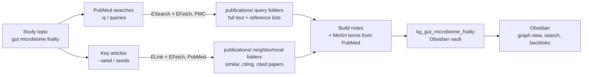
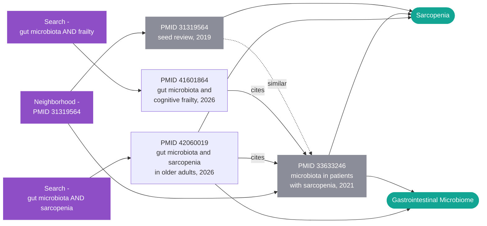

# pubmed-stream

[](https://pypi.org/project/pubmed-stream/)
[](https://www.python.org/downloads/)
[](https://opensource.org/licenses/MIT)

A Python library for downloading PubMed Central (PMC) full-text articles with support for concurrent downloads, automatic rate limiting, metadata extraction, and multiple output formats.

**Built on NCBI E-utilities API** for reliable, standards-compliant access to biomedical literature.

## Overview

`pubmed-stream` simplifies the process of downloading scientific literature from PubMed Central by leveraging the **NCBI E-utilities API** (ESearch and EFetch):
- **Searching PMC directly** and skipping articles whose publishers withhold the XML full text
- **Extracting structured metadata** from JATS XML (title, authors, abstract, keywords, DOI, etc.)
- **Supporting multiple formats**: plain text, raw XML, or both in a single JSON file
- **Handling concurrent downloads** with configurable thread pools
- **Respecting NCBI rate limits** with automatic detection and retry logic
- **Providing both CLI and Python API** for flexible integration
- **Mapping the evidence around an article**: similar, citing and cited papers flagged as reviews, retractions or NIH-funded (a programmatic take on NLM's Linked Discoveries)
- **Building an Obsidian knowledge graph**: papers linked by citations, similarity and MeSH concepts, ready to explore in Obsidian's graph view

Built for researchers and data scientists who need efficient, reliable access to biomedical literature.

## Quick Start

```bash
# Install
pip install pubmed-stream

# Download full-text articles for a query
pubmed-stream download "gut microbiome" --max-results 50

# Map the evidence around one article: similar, citing and cited papers, retractions flagged
pubmed-stream neighborhood 9500320

# Build a study's knowledge graph in ./kg_gut_microbiome_frailty, ready for Obsidian
pubmed-stream kg "gut microbiome frailty" -q "gut microbiome frailty" --seed 35803947
```

```python
from pubmed_stream import get_neighborhood, search_and_download

stats = search_and_download(keyword="CRISPR gene editing", max_results=100, fmt="text")
print(f"Downloaded {stats.successful} articles in {stats.duration_seconds:.1f}s")

hood = get_neighborhood("9500320")
print(hood.totals, [a.pmid for a in hood.articles() if a.is_retracted])
```

## Table of Contents

- [Installation](#installation)
- [How It Works](#how-it-works)
- [Configuration](#configuration-optional)
- [CLI Usage](#cli-usage)
- [Python API](#python-api)
- [Evidence Neighborhood](#evidence-neighborhood)
- [Obsidian Knowledge Graph](#obsidian-knowledge-graph)
- [Output Format](#output-format)
- [Use Cases](#use-cases)
- [Troubleshooting](#troubleshooting)
- [Performance Tuning](#performance-tuning)
- [Testing](#testing)
- [Contributing](#contributing)
- [License](#license)

New to the code? Start with the [architecture guide](https://github.com/melhzy/pubmed-stream/blob/main/docs/ARCHITECTURE.md).

## Installation

### From PyPI (Recommended)

```bash
pip install pubmed-stream
```

### From Source

```bash
# Clone the repository
git clone https://github.com/melhzy/pubmed-stream.git
cd pubmed-stream

# Install in standard mode
pip install .

# Or install in development mode (editable install)
pip install -e ".[dev]"
```

### Requirements

- Python 3.8+
- [requests](https://pypi.org/project/requests/) (only runtime dependency)

Development dependencies (optional):
- pytest (for testing)
- ruff (for linting)

## How It Works

> **The full picture:** [`docs/ARCHITECTURE.md`](https://github.com/melhzy/pubmed-stream/blob/main/docs/ARCHITECTURE.md) explains the whole repository with diagrams, tables, code and figures. It covers the module map, every NCBI request, the download and neighborhood flows, how knowledge graphs are built and safely rebuilt, the data model, the tests, and where to extend the code.

### Architecture

The library follows a modular design with three main components, all built on **NCBI E-utilities**:

1. **Search Module** (`esearch_pmc`)
   - Uses NCBI E-utilities **ESearch** to query PMC database directly
   - Returns PMC IDs for matching articles
   - Handles pagination and result limiting

2. **Download Module** (`efetch_pmc`)
   - Uses NCBI E-utilities **EFetch** to retrieve full XML article data from PMC
   - Extracts structured metadata using JATS XML parsing
   - Converts XML to readable plain text: title, abstract and body, one paragraph per line (optional)
   - Reports articles without XML full text (publisher restriction or PDF-only) as unavailable instead of saving them
   - Saves in requested format(s)

3. **Orchestration Layer** (`search_and_download`)
   - Combines search and download operations
   - Manages concurrent downloads with thread pools
   - Handles rate limiting, retries, and error recovery
   - Tracks statistics (success/failure/skipped counts)

### Search Strategy

**Direct PMC Search**: Unlike some tools that search PubMed and then try to find PMC links, this library searches PMC directly. This ensures:
- Every result is a PMC article, so no broken PubMed→PMC links
- Articles whose publishers withhold the XML full text are detected and reported as unavailable
- Faster, more reliable downloads
- Better results for generic queries like "microbiome" or "CRISPR"

### Data Flow

```
User Query → PMC Search → PMC IDs → Concurrent Downloads → Parse XML → Extract Metadata → Save JSON
     ↓            ↓            ↓             ↓                  ↓              ↓            ↓
 "microbiome"  E-Search   [123, 456]    Thread Pool      JATS Parser    {title, authors}  PMC*.json
```

### Output Format Options

All formats save as `.json` files with different content:

**`"text"` (default)**: JSON with plain-text content
```json
{
  "pmcid": "PMC12345678",
  "metadata": {"title": "...", "authors": [...]},
  "text": "Introduction\nThis study examines..."
}
```

**`"xml"`**: JSON with raw JATS XML string
```json
{
  "pmcid": "PMC12345678",
  "metadata": {"title": "...", "authors": [...]},
  "xml": "<article>...</article>"
}
```

**`"both"`**: JSON with both XML and text
```json
{
  "pmcid": "PMC12345678",
  "metadata": {"title": "...", "authors": [...]},
  "xml": "<article>...</article>",
  "text": "Introduction\nThis study examines..."
}
```

**Why unified JSON?**
- Consistent file handling (always `.json`)
- Metadata always included
- Easy to query and filter
- Smaller storage (text-only is ~50% smaller than XML)
- Backward compatible with existing pipelines

## Configuration (optional)

Set these environment variables for best results:

```bash
# PowerShell
$env:NCBI_API_KEY = "YOUR_KEY"   # raises rate limit from 3→10 req/s
$env:NCBI_EMAIL   = "you@example.com"

# Bash / Zsh
export NCBI_API_KEY="YOUR_KEY"
export NCBI_EMAIL="you@example.com"
```

You can also pass `--api-key` / `--email` on the command line.

### Rate Limits

NCBI enforces rate limits on API requests:

- **Without API key**: 3 requests/second
- **With API key**: 10 requests/second

The library **automatically detects** whether you have an API key and adjusts the rate limit accordingly:
- With API key: 0.1s between requests (10 req/s)
- Without API key: 0.34s between requests (3 req/s)

You can override this with `--rate-limit` if needed, but the auto-detection works well for most cases.

**Recommendation**: Get a free API key to download ~3x faster. Without a key, the library still works but is slower.

## CLI usage

After installation the `pubmed-stream` command is available:

```bash
# Download up to 50 articles as JSON (default, concurrent)
pubmed-stream download "frailty cytokines" --max-results 50

# Sequential mode for unstable networks
pubmed-stream download "gut microbiome" --sequential

# Custom output directory
pubmed-stream download "Alzheimer microbiome" -o ./my_papers

# Verbose logging
pubmed-stream download "frailty" -v --max-results 5

# Evidence neighborhood of an article (see Evidence Neighborhood)
pubmed-stream neighborhood 9500320

# Knowledge graph of a study (see Obsidian Knowledge Graph)
pubmed-stream kg "gut microbiome frailty" -q "gut microbiome frailty" -q "microbiome sarcopenia"

# Show version
pubmed-stream --version
```

The same interface is available via `python -m pubmed_stream`:

```bash
python -m pubmed_stream download "frailty cytokines" --max-results 50
```

### CLI options

| Flag | Description | Default |
|------|-------------|---------|
| `keyword` | PubMed search query (positional) | required |
| `--max-results` | Maximum articles to download | 100 |
| `--format` | Output format: `text`, `xml`, `both` (all save as `.json`) | `text` |
| `--output-dir`, `-o` | Base output directory | `./publications` |
| `--api-key` | NCBI API key | `NCBI_API_KEY` env var |
| `--email` | Contact email for NCBI | `NCBI_EMAIL` env var |
| `--sequential` | Disable concurrent downloads | concurrent |
| `--workers` | Concurrent thread count | 5 |
| `--exclude-text` | Omit `text` field in JSON (~30% smaller) | included |
| `--rate-limit` | Min seconds between requests | auto: 0.1 with key, 0.34 without |
| `--user-agent` | Custom HTTP `User-Agent` | `pubmed-stream/<ver>` |
| `--verbose`, `-v` | DEBUG-level logging | INFO |

### Exit codes (`download`)

| Code | Meaning |
|------|---------|
| 0 | At least one article downloaded (or all already cached) |
| 1 | No results found for the query |
| 2 | All download attempts failed |

## Python API

### Basic Usage

```python
from pubmed_stream import search_and_download

# Download articles with default settings
stats = search_and_download(
    keyword="gut microbiome inflammation",
    max_results=50,
    fmt="text",  # or "xml", "both"
    output_dir="publications",
)

print(f"Downloaded: {stats.successful}")
print(f"Skipped (already exist): {stats.skipped}")
print(f"Failed: {stats.failed}")
print(f"Success rate: {stats.success_rate:.1f}%")
print(f"Duration: {stats.duration_seconds:.1f}s")
```

### Advanced Usage

```python
from pubmed_stream import search_and_download
from pathlib import Path

# Full control over all parameters
stats = search_and_download(
    keyword="CRISPR gene editing",
    max_results=100,
    fmt="both",              # Save both XML and text
    api_key="your_api_key",  # Or use NCBI_API_KEY env var
    use_concurrent=True,     # Enable parallel downloads
    max_workers=10,          # Use 10 threads
    include_text=True,       # Include plain-text field
    output_dir=Path("./research/crispr"),
    user_agent="MyResearchBot/1.0",
    email="researcher@university.edu",
    rate_limit=0.15,         # Custom rate limit
)

# Access detailed statistics
print(f"Total found in PMC: {stats.total_found}")
print(f"Requested: {stats.requested}")
print(f"Output: {stats.output_dir}")
```

### Low-Level API

For more control, use the underlying functions:

```python
from pubmed_stream import esearch_pmc, efetch_pmc, create_session, RateLimiter
from pathlib import Path

# Create session and rate limiter
session = create_session("MyApp/1.0")
rate_limiter = RateLimiter(0.1)  # 10 req/s

# Search for PMC IDs
pmcids, total_found = esearch_pmc(
    term="microbiome AND aging",
    max_results=20,
    api_key="your_key",
    session=session,
    rate_limiter=rate_limiter
)

print(f"Found {len(pmcids)} PMC IDs (total: {total_found})")

# Download individual articles
for pmcid in pmcids:
    success, status = efetch_pmc(
        pmcid=pmcid,
        out_dir=Path("downloads"),
        fmt="text",
        api_key="your_key",
        session=session,
        rate_limiter=rate_limiter,
        include_text=True
    )
    
    if success:
        print(f"✓ Downloaded PMC{pmcid}")
    else:
        print(f"✗ Failed PMC{pmcid}: {status}")

session.close()
```

### Metadata Extraction

The library automatically extracts metadata from JATS XML:

```python
from pubmed_stream import extract_metadata_from_pmc_xml, extract_text_from_pmc_xml

xml_content = """<article>...</article>"""  # Your PMC XML

metadata = extract_metadata_from_pmc_xml(xml_content)
text = extract_text_from_pmc_xml(xml_content)  # Same as the "text" field

# Available metadata fields
print(metadata.get("title"))          # Article title
print(metadata.get("journal"))        # Journal name
print(metadata.get("doi"))            # DOI
print(metadata.get("pmid"))           # PubMed ID
print(metadata.get("pmcid"))          # PMC ID
print(metadata.get("authors"))        # List of authors
print(metadata.get("abstract"))       # Abstract text
print(metadata.get("keywords"))       # Keywords list
print(metadata.get("year"))           # Publication year
print(metadata.get("pub_date"))       # Full publication date
print(metadata.get("linked_discoveries_url"))  # NLM Linked Discoveries page (when a PMID exists)
```

## Evidence Neighborhood

NLM's [Linked Discoveries](https://linkeddiscoveries.ncbi.nlm.nih.gov/userguide/) shows the "neighborhood" of a PubMed article: related publications, citation links, reviews, retractions and NIH-funded work. It is a web tool without a public API, so pubmed-stream builds a comparable neighborhood from documented NCBI E-utilities:

| Relation / flag | Source |
|-----------------|--------|
| Similar articles, ranked by score | ELink `pubmed_pubmed` |
| Cited by | ELink `pubmed_pubmed_citedin` |
| References | ELink `pubmed_pubmed_refs` |
| Review, retracted, NIH-funded, PMC ID | EFetch PubMed XML (publication types, retraction notices, grant list) |

One neighborhood costs two requests (one ELink, plus one EFetch per 200 articles), plus five for each relation cut short by `--max-per-relation`.

What the flags mean:
- **review**: publication type Review, Systematic Review or Scoping Review. This is narrower than PubMed's Review filter, which also counts guidelines and meta-analyses.
- **retracted**: publication type Retracted Publication, or a retraction notice linked to the article.
- **NIH-funded**: an NIH grant in the grant list, or an N.I.H. research-support publication type.
- **in PMC**: the article has a PMC ID; its full text may still be withheld by the publisher.

### Step by step

1. **Install pubmed-stream** ([Installation](#installation)). Optionally set `NCBI_API_KEY` and `NCBI_EMAIL` ([Configuration](#configuration-optional)); an API key raises NCBI's limit from 3 to 10 requests per second.

2. **Find the article's PMID.** It is the number in the PubMed URL (`https://pubmed.ncbi.nlm.nih.gov/9500320/` → `9500320`), or the `metadata.pmid` field of an article saved by `pubmed-stream download`. PMC IDs (`PMC…`) are not accepted.

3. **Run the command:**

   ```bash
   pubmed-stream neighborhood 9500320
   ```

4. **Read the summary:**

   ```
   Seed: PMID 9500320 (1998) Ileal-lymphoid-nodular hyperplasia, non-specific colitis, and ...
   Similar       100            (4 reviews, 0 retracted, 0 NIH-funded, 18 in PMC)
   Cited by      100 of 489     (145 reviews, 0 retracted, 52 NIH-funded, 421 in PMC)
   References      0            (0 reviews, 0 retracted, 0 NIH-funded, 0 in PMC)
   Neighborhood  200 unique articles fetched
   [RETRACTED] PMID 9500320 (1998) Ileal-lymphoid-nodular hyperplasia, non-specific colitis, and ...
   Saved: publications/neighborhood_9500320/neighborhood.json
   Explore the graph: https://linkeddiscoveries.ncbi.nlm.nih.gov/9500320/
   ```

   - **Seed**: the article you asked about.
   - **Similar / Cited by / References**: how many articles were fetched in detail. `100 of 489` means 489 PubMed articles cite the seed and the newest 100 were fetched. Similar articles are ordered most similar first.
   - **The counts in brackets always cover all linked articles** (all 489 here). When a list is cut short, they are counted with PubMed search (one EPost plus four ESearch requests) rather than by downloading every record.
   - **Neighborhood**: distinct articles fetched across the three lists (an article can be both similar and citing).
   - **[RETRACTED]**: every retracted article among the seed and the fetched neighbors. Check these before citing or building on them.
   - **Saved / Explore the graph**: where the results were written, and the article's Linked Discoveries page for graph and timeline views and condition/gene/chemical filters.

5. **Work with the results** in `neighborhood.json` (fields [below](#python)). For example, the NIH-funded reviews that cite the seed:

   ```python
   import json

   hood = json.load(open("publications/neighborhood_9500320/neighborhood.json", encoding="utf-8"))
   for article in hood["cited_by"]:
       if article["is_review"] and article["nih_funded"]:
           print(article["year"], article["pmid"], article["title"])
   ```

6. **Get the full text (optional).** `--download` saves the PMC full text of the seed and every fetched neighbor that has one, as `PMC*.json` files next to `neighborhood.json`, in the same format as `pubmed-stream download`. Articles without PMC full text, or whose publisher withholds the XML, are counted as unavailable. Re-running skips files that already exist.

   ```bash
   pubmed-stream neighborhood 9500320 --download
   ```

7. **Fetch more or fewer articles.** `--max-per-relation N` sets how many articles per list are fetched in detail (default 100). Raise it to fetch more citing articles or references; similar articles never exceed 100, which is NCBI's limit.

### CLI reference

```bash
pubmed-stream neighborhood PMID [--max-per-relation N] [--download] [options]
```

`neighborhood` accepts `--max-per-relation` (default 100), `--download`, the download options (`--format`, `--workers`, `--sequential`, `--exclude-text`) and the common options (`--api-key`, `--email`, `-o`, `--rate-limit`, `-v`). Results go to `<output-dir>/neighborhood_<PMID>/` (default `./publications`). `pubmed-stream neighborhood --help` shows examples.

Exit codes: `0` success, `1` invalid PMID or not found in PubMed, `2` NCBI could not be reached.

### Python

```python
from pubmed_stream import download_neighborhood, get_neighborhood, save_neighborhood

hood = get_neighborhood("9500320")
print(hood.seed.title, hood.linked_discoveries_url)
print(hood.totals)  # {"similar": 100, "cited_by": 489, "references": 0}, uncapped counts
print(hood.flag_counts["cited_by"])  # {"reviews": 145, "retracted": 0, "nih_funded": 52, "in_pmc": 421}, all 489

for article in hood.cited_by:
    print(article.pmid, article.year, article.title,
          article.is_review, article.is_retracted, article.nih_funded, article.pmcid)

retracted = [a for a in hood.articles() if a.is_retracted]  # seed + neighbors, deduplicated

save_neighborhood(hood)              # publications/neighborhood_9500320/neighborhood.json
stats = download_neighborhood(hood)  # PMC full text of seed + neighbors (DownloadStats)
```

`neighborhood.json` holds `pmid`, `seed`, `similar`, `cited_by`, `references`, `totals` (uncapped count per relation), `flag_counts` (review/retracted/NIH-funded/in-PMC counts across all of them), `linked_discoveries_url` and `retrieved`; each article looks like:

```json
{
  "pmid": "31358387",
  "title": "No CFH or ARMS2 Interaction with Omega-3 Fatty Acids, ...",
  "journal": "Ophthalmology",
  "year": "2019",
  "authors": ["van Asten Freekje", "Chiu Chi-Yang", "..."],
  "pub_types": ["Comparative Study", "Journal Article", "Randomized Controlled Trial",
                "Research Support, N.I.H., Intramural", "Research Support, Non-U.S. Gov't"],
  "is_review": false,
  "is_retracted": false,
  "nih_funded": true,
  "pmcid": "PMC6810822",
  "doi": "10.1016/j.ophtha.2019.06.004",
  "score": 69336037
}
```

**How it differs from Linked Discoveries**
- Similarity comes from PubMed's Similar Articles algorithm, not the BiomedBERT model Linked Discoveries uses, so the neighbors can differ.
- There are no condition/gene/chemical filters and no graph or timeline view; `linked_discoveries_url` links each seed to its page in the web tool.
- Citation links come from PubMed/PMC citation data and are incomplete for articles without deposited reference lists.
- Like the web tool, the flags describe connections; they do not judge whether a study is credible or has been replicated.

### Common workflows

**Check whether a key paper cites retracted work:**

```python
from pubmed_stream import get_neighborhood

hood = get_neighborhood("29096998")
for article in hood.references:
    if article.is_retracted:
        print("Cites retracted article:", article.pmid, article.title)
```

**Expand a literature search from one paper.** Download the full text of its similar and citing articles, then process the `PMC*.json` files like any keyword download:

```bash
pubmed-stream neighborhood 29096998 --max-per-relation 50 --download
```

**Build neighborhoods for articles you already downloaded:**

```python
import json
from pathlib import Path
from pubmed_stream import get_neighborhood, save_neighborhood

for path in Path("publications/gut_microbiome").glob("PMC*.json"):
    pmid = json.loads(path.read_text(encoding="utf-8"))["metadata"].get("pmid")
    if pmid:
        save_neighborhood(get_neighborhood(pmid, max_per_relation=20))
```

Each neighborhood takes 2 to about 17 requests, so set `NCBI_API_KEY` for batches like this.

### Troubleshooting

- **`'PMC…' is a PMC ID`**: pass the PubMed ID. Downloaded files have it in `metadata.pmid`.
- **`PMID … not found in PubMed`** (exit 1): check the number. Deleted or merged records are not found.
- **`could not reach NCBI`** (exit 2): each request is retried three times. Try again later, or slow down with `--rate-limit 0.5`.
- **Few or no references or citations**: NCBI only has citation links where reference lists were deposited, mostly for PMC articles. Older or paywalled articles often show 0 references, as PMID 9500320 does.
- **Slow**: set `NCBI_API_KEY`.

## Obsidian Knowledge Graph

`pubmed-stream kg` builds the knowledge graph of a scientific study. It runs the study's PubMed searches and evidence neighborhoods, then links everything in an [Obsidian](https://obsidian.md) vault: a folder of Markdown notes named `kg_<topic>`. Open the folder in Obsidian with **Open folder as vault**, then use the graph view to see which papers cite each other and which topics they share.

**One knowledge graph per study topic.** Obsidian links notes only inside one vault, so everything a study collects goes into the same `kg_<topic>` folder, created in the current folder next to `publications/`. There, shared citations and MeSH concepts connect the searches and neighborhoods into one graph.

> **New to this?** The tutorial notebook [`examples/kg_tutorial.ipynb`](https://github.com/melhzy/pubmed-stream/blob/main/examples/kg_tutorial.ipynb) builds a real study step by step and shows every note it produces, with outputs saved. [`examples/kg_study.py`](https://github.com/melhzy/pubmed-stream/blob/main/examples/kg_study.py) is the same study as a script to copy and adapt.

### How it works



1. **Collect.** Each search downloads PMC full text, including the article's reference list. Each seed fetches its evidence neighborhood from PubMed.
2. **Enrich.** MeSH headings and publication types come from PubMed, once per 200 papers, and are cached in the graph folder.
3. **Link.** Every paper, MeSH concept and collection becomes a Markdown note. Citations, similarity and topics become wikilinks, which Obsidian draws as the graph.
4. **Remember.** The study's searches and seeds are saved in the graph, so it can be rebuilt or refreshed with only its topic.

### Step by step

1. **Start the study** with its topic, its searches and, optionally, key articles whose similar, citing and cited papers belong in it:

   ```bash
   pubmed-stream kg "gut microbiome frailty" \
       -q "gut microbiome frailty" -q "microbiome sarcopenia" \
       --seed 35803947 --max-results 50 --max-per-relation 30
   ```

2. **Open `kg_gut_microbiome_frailty` in Obsidian.** Start at the `PubMed Stream` home note, which lists the collections, the most connected concepts and any retracted papers.

3. **Grow the study.** Later runs with the same topic add to its graph:

   ```bash
   pubmed-stream kg "gut microbiome frailty" -q "microbiome inflammaging"
   pubmed-stream kg "gut microbiome frailty" --add ./publications/old_query   # folders downloaded earlier
   ```

4. **Keep it current.** The study remembers its searches and seeds. `--refresh` runs them all again and adds newly published papers; articles already downloaded are skipped:

   ```bash
   pubmed-stream kg "gut microbiome frailty" --refresh
   ```

   With no options, `pubmed-stream kg "gut microbiome frailty"` only rebuilds the notes, for example to pick up MeSH terms PubMed has indexed since.

`download` and `neighborhood` can join a study too: add `--topic "gut microbiome frailty"`. Their search or seed is then recorded in the study like one made with `kg`.

| Run | Knowledge graph folder |
|-----|------------------------|
| `kg "gut microbiome frailty" ...` | `kg_gut_microbiome_frailty` |
| `download "gut microbiome" --topic "frailty study"` | `kg_frailty_study` |
| `download "gut microbiome" --vault` | `kg_gut_microbiome`, named after the query |
| `neighborhood 35803947 --vault` | `kg_neighborhood_35803947` |
| `kg ... --kg-dir DIR`, or `download`/`neighborhood` with `--vault DIR` | `DIR`, for a different name or location |

### What the vault contains

| Note | Location | Links to |
|------|----------|----------|
| Paper | `papers/PMID<id>.md` | Papers it cites, papers citing it, similar papers, its MeSH concepts and collections |
| Concept | `concepts/<MeSH heading>.md` | Papers indexed with that MeSH heading |
| Collection | `collections/Search - <query>.md` or `collections/Neighborhood - PMID <id>.md` | Its papers and top concepts |
| Home | `PubMed Stream.md` | Collections, most connected concepts, retracted papers |

A slice of the graph built by [`examples/kg_study.py`](https://github.com/melhzy/pubmed-stream/blob/main/examples/kg_study.py) shows how the notes connect. Every link below is real. Purple notes are collections, white ones papers with full text, grey ones stubs, and teal ones MeSH concepts, as in Obsidian's graph view:



The two 2026 studies came from different searches, yet both cite the same 2021 study, which PubMed also rates as similar to the seed review. In the graph they sit next to each other, a connection a list of search results hides.

Here is a paper note from that graph, shortened. Obsidian shows the part between the `---` lines as editable properties:

```markdown
---
type: "paper"
title: "Association between gut microbiota and sarcopenia in older adults: a cross-sectional analysis ..."
pmid: "42060019"
pmcid: "PMC13279599"
doi: "10.1007/s40520-026-03403-6"
year: 2026
journal: "Aging Clinical and Experimental Research"
authors:
  - "Ramezani Kashal Fatemeh"
  - ...
mesh:
  - "Sarcopenia"
  - "Gastrointestinal Microbiome"
  - ...
status: "full-text"
tags:
  - "pubmed/paper"
---
%% pubmed-stream:start - generated; edits inside this block are overwritten %%
# Association between gut microbiota and sarcopenia in older adults: ...

**Published:** *Aging Clinical and Experimental Research* · 2026 · [PubMed](...) · [PMC](...) · [DOI](...)
**Collections:** [[Search - gut microbiota(Title) AND sarcopenia(Title-Abstract)]]

## Abstract

Introduction Investigating gut microbiota has emerged as a novel approach to exploring the gut-muscle axis ...

## MeSH concepts

- [[Sarcopenia]] (major topic)
- [[Gastrointestinal Microbiome]] (major topic)
- [[Hand Strength]]
- ...

## Cites (39)

- [[PMID32033882|Asian Working Group for Sarcopenia: 2019 Consensus Update on Sarcopenia Diagnosis and Treatment (2020)]]
- [[PMID33633246|Alterations in intestinal microbiota diversity, composition, and function in patients with sarcop... (2021)]]
- ...

## Cited by (1)

- [[PMID42875678|Correspondence for the article: “Association between gut microbiota and sarcopenia in older adult... (2026)]]
%% pubmed-stream:end %%

## Notes

Your own notes go here and survive every rebuild.
```

Paper notes carry Obsidian properties: `pmid`, `pmcid`, `doi`, `year`, `journal`, `authors`, `publication_types`, `mesh`, `keywords`, `status` and `tags`. They work in Obsidian search, Bases and the Dataview plugin. Tags mark the kind of note and its flags: `pubmed/paper`, `pubmed/stub`, `pubmed/review`, `pubmed/retracted`, `pubmed/nih-funded`, `pubmed/concept` and `pubmed/collection`. On the first build, the graph view gets colour groups for retracted papers, reviews, stubs, concepts and collections, unless the vault already has its own graph settings.

### Where the links come from

- **Citations** come from the reference lists of downloaded full text, for references with a PMID, and from neighborhood citing and cited papers. References with only a DOI are listed under *Other references* with a link.
- **Similarity** comes from neighborhood similar articles, with PubMed's similarity score.
- **Concepts** are MeSH headings from PubMed. They are fetched once per 200 papers and cached in `.pubmed-stream/pubmed_records.json` inside the vault. Check tags such as *Humans*, *Male* or *Aged* stay in the `mesh` property but get no concept note, because they would link almost every paper.
- **Stubs** are neighborhood papers that were not downloaded. They get a short note tagged `pubmed/stub` with their PubMed details. Cited papers with no known details stay as unresolved links, which Obsidian can turn into notes on click.

### Editing notes safely

Each note keeps its generated content between two markers:

```markdown
%% pubmed-stream:start - generated; edits inside this block are overwritten %%
...
%% pubmed-stream:end %%

## Notes
```

Write your own notes below the block or anywhere outside it; rebuilds never touch that text. In the frontmatter, the tool replaces only the keys it writes. Your own properties are kept, and so are your own tags and aliases. Notes whose content did not change are not rewritten, which keeps sync tools quiet.

Do not rename or move generated notes. A rebuild would create the note again at its original path; link to the note instead.

### CLI reference

`pubmed-stream kg TOPIC` takes these options, plus the download options of `download` such as `--format`, `--workers` and `-o`:

| Flag | Description | Default |
|------|-------------|---------|
| `TOPIC` | Study topic; the graph is `./kg_<topic>` | required |
| `--query`, `-q` | PubMed search to download into the study; repeatable | None |
| `--seed`, `-s` | PMID of a key article whose evidence neighborhood joins the study; repeatable | None |
| `--add DIR` | Folder or file downloaded earlier; repeatable | None |
| `--refresh` | Run every remembered search and seed again | Only new ones |
| `--max-results` | Articles per search | 100 |
| `--max-per-relation` | Similar, citing and cited articles per seed | 100 |
| `--download-neighbors` | Download PMC full text of neighborhood articles too | Stub notes |
| `--kg-dir DIR` | Graph folder, instead of `./kg_<topic>` | `./kg_<topic>` |
| `--fulltext` | Put each article's full text into its note | Abstract only |
| `--offline` | Do not query PubMed for MeSH terms; use the cache | Fetch missing MeSH terms |

Exit codes: 0 when everything worked, 1 when there is nothing to build or an option is invalid, 2 when a search or neighborhood failed. The graph is still built from everything else.

`download` and `neighborhood` accept `--topic`, `--fulltext` and `--offline` too, and `--vault` with or without a folder. They add to a knowledge graph only when given `--topic` or `--vault`. Put a bare `--vault` after the search query, so it is not read as the folder name.

### Python

```python
from pubmed_stream import create_kg

result = create_kg(
    "gut microbiome frailty",
    queries=["gut microbiome frailty", "microbiome sarcopenia"],
    seeds=["35803947"],
    max_results=50,
)
print(result)               # searches, seeds, errors and the graph's notes
print(result.kg_dir)        # .../kg_gut_microbiome_frailty
create_kg("gut microbiome frailty", refresh=True)  # later: pick up new papers
```

| Function | Purpose |
|----------|---------|
| `create_kg(topic, queries, seeds, sources, refresh, ...)` | Run a study's searches and neighborhoods and build its graph; returns a `KGResult` |
| `load_study(kg_dir)` | The topic, searches and seeds recorded in a graph |
| `record_study(kg_dir, topic, queries, seeds)` | Record searches or seeds run elsewhere, so `refresh` repeats them |
| `build_vault(sources, vault_dir, ...)` | Lower level: build the notes from download folders only; returns `VaultStats` |
| `topic_vault_dir(topic)` | The `kg_<topic>` folder for a topic |

### Tutorial and examples

| File | What it shows |
|------|---------------|
| [`examples/kg_tutorial.ipynb`](https://github.com/melhzy/pubmed-stream/blob/main/examples/kg_tutorial.ipynb) | A guided study on the gut microbiome and frailty, with saved outputs: one search, the folder layout, a paper note, a concept note, the home note, a key article's neighborhood, citation links, editing notes safely, and refreshing |
| [`examples/kg_study.py`](https://github.com/melhzy/pubmed-stream/blob/main/examples/kg_study.py) | The same study as a short script. Edit its `STUDY` settings, run it, and run it again with `--refresh` later |

Run the tutorial from the `examples` folder; it works in `examples/kg_tutorial_workspace/`, which git ignores:

```bash
pip install jupyter
cd examples
jupyter notebook kg_tutorial.ipynb
```

### Limitations

- **Recent papers often lack MeSH terms.** Indexing takes months, and journals outside MEDLINE are never indexed. In a test with 2025 and 2026 papers, about half had no MeSH terms, so they have no concept links yet. Rebuild later to pick them up.
- **Older downloads have no reference lists.** Files downloaded with pubmed-stream 0.1.1 or earlier carry no `references`, unless they were saved with `--format xml` or `both`. Download them again into a new folder to add citation links.
- **Many references have no PMID.** Conference papers, preprints and books appear under *Other references*, not in the graph.
- **Notes are never deleted.** Removing a source folder leaves its notes in the vault.

## Output Format

### Directory Structure

Articles are organized by search query:

```
publications/
  gut_microbiome_inflammation/
    query.json          # the original search query
    PMC12345678.json
    PMC12345679.json
    PMC12345680.json
  alzheimer_disease/
    PMC11111111.json
    PMC22222222.json
```

Query strings are slugified (spaces→underscores, special characters removed) for clean directory names.

### JSON Schema

Each JSON file contains:

```json
{
  "pmcid": "PMC12345678",
  "source": "PMC",
  "download_date": "2026-02-17T12:30:45.123456",
  "metadata": {
    "title": "The Role of Gut Microbiome in Inflammation",
    "journal": "Nature Medicine",
    "journal_title": "Nature Medicine",
    "journal_nlm_ta": "Nat Med",
    "journal_iso_abbrev": "Nat. Med.",
    "doi": "10.1038/s41591-024-12345-6",
    "pmid": "38123456",
    "pmcid": "PMC12345678",
    "linked_discoveries_url": "https://linkeddiscoveries.ncbi.nlm.nih.gov/38123456/",
    "year": "2024",
    "month": "11",
    "day": "15",
    "pub_date": {
      "year": "2024",
      "month": "11",
      "day": "15"
    },
    "authors": [
      "Smith, John A.",
      "Johnson, Mary B.",
      "Williams, Robert C."
    ],
    "abstract": "Background: The gut microbiome plays a crucial role...",
    "keywords": [
      "microbiome",
      "inflammation",
      "gut health"
    ],
    "references": [
      {"pmid": "31234567", "doi": "10.1000/xyz123", "title": "A cited article", "year": "2019"}
    ]
  },
  "text": "Introduction\nThe human gut microbiome comprises...",
  "xml": "<article>...</article>"
}
```

**Field descriptions:**
- `pmcid`: PubMed Central identifier
- `source`: Always "PMC"
- `download_date`: ISO 8601 timestamp
- `metadata`: Structured article information. `references` lists the cited works that have a PMID or DOI, with title and year when the citation is structured.
- `text`: Plain text of the title, abstract and body, one paragraph per line; identifiers and references are excluded (if `fmt="text"` or `fmt="both"`)
- `xml`: Raw JATS XML string (if `fmt="xml"` or `fmt="both"`)

### Format Comparison

| Format | File Type | Contains | Use Case | Size |
|--------|-----------|----------|----------|------|
| `text` | `.json` | metadata + text | Vector DBs, search, NLP | Smallest (~50% of XML) |
| `xml` | `.json` | metadata + xml | Section parsing, structure analysis | Medium |
| `both` | `.json` | metadata + xml + text | Comprehensive analysis | Largest |

## Use Cases

### 1. Literature Review & Meta-Analysis

```python
# Download recent papers on a specific topic
stats = search_and_download(
    keyword="COVID-19 vaccine efficacy",
    max_results=200,
    fmt="text",
    output_dir="covid19_review"
)

# Process downloaded articles
import json
from pathlib import Path

for json_file in Path("covid19_review/covid_19_vaccine_efficacy").glob("*.json"):
    with open(json_file) as f:
        article = json.load(f)
    
    print(f"Title: {article['metadata']['title']}")
    print(f"Year: {article['metadata']['year']}")
    print(f"Abstract: {article['metadata']['abstract'][:200]}...")
```

### 2. Vector Database Embedding

```python
# Download for embedding into vector database
stats = search_and_download(
    keyword="machine learning healthcare",
    max_results=1000,
    fmt="text",  # Plain text is ideal for embeddings
    include_text=True
)

# Example: Embed into ChromaDB
import chromadb
from pathlib import Path
import json

client = chromadb.Client()
collection = client.create_collection("medical_papers")

for json_file in Path("publications/machine_learning_healthcare").glob("*.json"):
    with open(json_file) as f:
        article = json.load(f)
    
    collection.add(
        documents=[article["text"]],
        metadatas=[{
            "title": article["metadata"]["title"],
            "year": article["metadata"]["year"],
            "doi": article["metadata"].get("doi", ""),
        }],
        ids=[article["pmcid"]]
    )
```

### 3. Section-Level Analysis

```python
# Download with XML for detailed structure parsing
stats = search_and_download(
    keyword="CRISPR therapy clinical trials",
    max_results=50,
    fmt="xml"  # Get raw XML for section extraction
)

# Parse sections from XML
import xml.etree.ElementTree as ET
import json
from pathlib import Path

for json_file in Path("publications/crispr_therapy_clinical_trials").glob("*.json"):
    with open(json_file) as f:
        article = json.load(f)
    
    # Parse XML to extract sections
    root = ET.fromstring(article["xml"])
    
    # Find all sections with sec-type attribute
    for sec in root.findall(".//sec[@sec-type]"):
        sec_type = sec.get("sec-type")
        title = sec.find("title")
        
        if title is not None:
            print(f"Section: {sec_type} - {title.text}")
```

### 4. Batch Processing with Keywords

```python
# Process multiple queries from CSV
import pandas as pd

keywords_df = pd.read_csv("research_keywords.csv")

for _, row in keywords_df.iterrows():
    print(f"Processing: {row['keyword']}")
    
    stats = search_and_download(
        keyword=row['keyword'],
        max_results=row['max_articles'],
        fmt="both",  # Get both formats for flexibility
        output_dir="batch_download"
    )
    
    print(f"  Downloaded: {stats.successful}, Success rate: {stats.success_rate:.1f}%")
```

## Troubleshooting

### Common Issues

**1. "0 downloads" but high PMC result count**
- **Cause**: Files already downloaded (skipped)
- **Solution**: Check `stats.skipped` - this is actually success! Delete folder to re-download.

**2. Rate limiting (HTTP 429)**
- **Cause**: Exceeding NCBI rate limits
- **Solution**: 
  - Get a free API key (increases limit from 3→10 req/s)
  - Use `--rate-limit` to slow down: `--rate-limit 0.5`
  - The library automatically retries with backoff

**3. "Unavailable" articles**
- **Cause**: The publisher does not allow downloading the full text in XML form (common outside the open-access subset), the article is PDF-only, or it is not available in PMC
- **Solution**: Normal - these articles are counted as unavailable and not saved. Add `AND "open access"[filter]` to your query to search only the open-access subset.

**4. Network timeouts**
- **Cause**: Unstable internet connection
- **Solution**: Use `--sequential` mode: `pubmed-stream download "query" --sequential`

**5. Memory issues with large downloads**
- **Cause**: Processing too many articles concurrently
- **Solution**: Reduce workers: `--workers 2` or use `--sequential`

### Debugging

Enable verbose logging to see detailed information:

```bash
pubmed-stream download "microbiome" -v --max-results 10
```

```python
import logging
logging.basicConfig(level=logging.INFO)
# Only this package: urllib3's DEBUG output would log request URLs, including your API key
logging.getLogger("pubmed_stream").setLevel(logging.DEBUG)

from pubmed_stream import search_and_download
stats = search_and_download(keyword="test", max_results=5)
```

## Performance Tuning

### Concurrent vs Sequential

**Concurrent (default)**: Faster for stable networks
```bash
pubmed-stream download "query" --workers 10  # 10 parallel downloads
```

**Sequential**: More reliable for unstable networks
```bash
pubmed-stream download "query" --sequential
```

### Optimal Settings by Network

| Network Quality | Mode | Workers | Rate Limit |
|----------------|------|---------|------------|
| Excellent | Concurrent | 10 | 0.1 (with API key) |
| Good | Concurrent | 5 | 0.1 |
| Fair | Concurrent | 2-3 | 0.2 |
| Poor | Sequential | 1 | 0.34 |

### Performance Benchmarks

Typical download speeds (with API key, 5 workers):
- **Small articles** (~50KB): 2-5 articles/second
- **Medium articles** (~200KB): 1-3 articles/second
- **Large articles** (~1MB): 0.5-1 articles/second

Example: 100 medium-sized articles ≈ 45-60 seconds

Note: The raw XML is not included in JSON format to save storage. Use `--format xml` if you need the raw XML.

## Testing

The repository includes a comprehensive Jupyter notebook for testing all features:

```bash
# Install Jupyter
pip install jupyter

# Launch test notebook
jupyter notebook test_download.ipynb
```

For the knowledge graph, see the tutorial notebook `examples/kg_tutorial.ipynb` described under [Obsidian Knowledge Graph](#obsidian-knowledge-graph).

The test notebook demonstrates:
- Basic and advanced download scenarios
- All format options (text, xml, both)
- Concurrent vs sequential modes
- Error handling and edge cases
- Performance comparisons
- Low-level API usage

### Running Tests

```bash
# Install development dependencies
pip install -e ".[dev]"

# Run the unit tests (offline; NCBI responses are mocked)
pytest
```

## Contributing

Contributions are welcome! Please:

1. Fork the repository
2. Create a feature branch: `git checkout -b feature-name`
3. Make your changes with clear commit messages
4. Add tests if applicable
5. Ensure code passes linting: `ruff check .`
6. Submit a pull request

### Code Style

- Follow PEP 8
- Use type hints where appropriate
- Add docstrings for public functions
- Keep functions focused and modular

### Releasing to PyPI

Maintainers publish new versions by hand. Replace `X.Y.Z` with the new version.

1. **Bump the version** in both places that declare it, and keep them identical:
   - `pyproject.toml`: `version = "X.Y.Z"`
   - `pubmed_stream/__init__.py`: `__version__ = "X.Y.Z"`
2. **Run the tests** and make sure they pass: `pytest`
3. **Build and check the distributions** (the `dist/` folder is git-ignored):

   ```bash
   pip install --upgrade build twine
   rm -rf dist build *.egg-info
   python -m build
   python -m twine check dist/*
   ```

4. **Upload to PyPI** with an API token. Create one at
   <https://pypi.org/manage/account/token/>, scoped to the `pubmed-stream` project.
   The username is literally `__token__`; your PyPI password will not work.

   ```bash
   python -m twine upload -u __token__ -p pypi-... dist/*
   ```

   A `403 Forbidden` means the token is wrong, expired, or not scoped to this project.
   PyPI never lets you re-upload a version, so if a release is broken, bump to a new
   patch version instead of trying to overwrite it.

5. **Commit and tag** the release, then push both:

   ```bash
   git commit -am "chore: Bump version to X.Y.Z"
   git tag X.Y.Z
   git push origin main X.Y.Z
   ```

   If the tag already exists but points at the wrong commit, move it and force-push
   only that tag (never force-push `main`):

   ```bash
   git tag -f X.Y.Z <commit>
   git push --force origin refs/tags/X.Y.Z
   ```

6. **Create the GitHub release** for the tag. Either way, generate the notes from the
   merged pull requests and attach the two files from `dist/`.

   - **Web UI:** open `https://github.com/melhzy/pubmed-stream/releases/new?tag=X.Y.Z`,
     set the title to `X.Y.Z`, click **Generate release notes**, drag in
     `dist/pubmed_stream-X.Y.Z-py3-none-any.whl` and `dist/pubmed_stream-X.Y.Z.tar.gz`,
     then **Publish release**.
   - **GitHub CLI:** requires the [`gh`](https://cli.github.com/) tool
     (`winget install GitHub.cli` on Windows) and a one-time `gh auth login`.

     ```bash
     gh release create X.Y.Z --title "X.Y.Z" --generate-notes dist/*
     ```

7. **Verify** the new version installs cleanly: `pip install --upgrade pubmed-stream` and
   `pubmed-stream --version`.

## Development Roadmap

Future enhancements being considered:
- [ ] Support for PubMed (non-PMC) abstracts
- [ ] Advanced search query builder
- [ ] Automatic deduplication
- [ ] Progress bars for CLI
- [ ] Export to BibTeX/RIS formats
- [ ] Integration with citation managers
- [ ] Parallel processing for metadata extraction

## FAQ

**Q: Why JSON instead of separate XML/TXT files?**  
A: Unified JSON format provides consistent structure, always includes metadata, and simplifies file operations. You can still get raw XML (as a string field) if needed.

**Q: Can I use this for commercial purposes?**  
A: Yes, under the MIT license. However, respect NCBI's usage policies and rate limits.

**Q: How do I get an NCBI API key?**  
A: Register at https://www.ncbi.nlm.nih.gov/account/ and generate an API key in your account settings. It's free.

**Q: Does this violate NCBI terms of service?**  
A: No - this library is built on official NCBI E-utilities APIs (ESearch and EFetch), respects rate limits, and includes proper user-agent headers in compliance with NCBI usage policies.

**Q: Can I resume interrupted downloads?**  
A: Yes - already-downloaded files are automatically skipped (shown in `stats.skipped`).

**Q: What's the difference between PMC and PubMed?**  
A: PubMed contains citation abstracts for millions of papers. PMC (PubMed Central) is a subset with full-text articles. This library accesses PMC for complete article text.

## Project Structure

```
pubmed-stream/
├── pubmed_stream/              # Main package
│   ├── __init__.py            # Public API exports
│   ├── __main__.py            # python -m pubmed_stream entry point
│   ├── cli.py                 # Command-line interface
│   ├── downloader.py          # Core download logic
│   ├── neighborhood.py        # Evidence neighborhood (similar, citing, cited articles)
│   ├── kg.py                  # Study knowledge graphs: searches, neighborhoods, refresh
│   ├── vault.py               # Obsidian vault notes for the knowledge graph
│   └── py.typed               # Type hint marker
├── examples/
│   ├── kg_tutorial.ipynb      # Knowledge graph tutorial, with outputs
│   ├── kg_study.py            # Knowledge graph example script
│   ├── keywords/              # Sample keyword CSV files
│   │   ├── pmc_literature_keywords.csv
│   │   └── ...
│   └── utils/                 # Helper scripts
│       ├── manage_text_field.py
│       └── test_pmc_availability.py
├── tests/                     # pytest suite with small JATS XML fixtures
├── docs/
│   ├── ARCHITECTURE.md        # How the repository works: diagrams, tables, figures
│   └── figures/               # Figures of the example study, and make_figures.py
├── test_download.ipynb        # Comprehensive test notebook
├── pyproject.toml            # Project metadata and dependencies
├── README.md                 # This file
└── .gitignore               # Git ignore rules
```

## Acknowledgments

This library was developed to support biomedical research at the **University of Massachusetts** by:
- **Haran Lab**
- **Bucci Lab**
- **Microbiology & Microbiome Dynamics AI HUB**

Special thanks to:
- **NCBI** for providing the E-utilities API and open access to PubMed Central
- The open-source community for Python ecosystem tools

## Citation

If you use this library in your research, please cite:

```bibtex
@software{pubmed_stream_2026,
  title = {pubmed-stream: Python Library for PMC Article Downloads via NCBI E-utilities},
  author = {Haran Lab and Bucci Lab and Microbiology \& Microbiome Dynamics AI HUB},
  organization = {University of Massachusetts},
  year = {2026},
  url = {https://github.com/melhzy/pubmed-stream},
  note = {Built on NCBI E-utilities API}
}
```

## License

MIT License

Copyright (c) 2026 University of Massachusetts  
Haran Lab, Bucci Lab, and Microbiology & Microbiome Dynamics AI HUB

Permission is hereby granted, free of charge, to any person obtaining a copy
of this software and associated documentation files (the "Software"), to deal
in the Software without restriction, including without limitation the rights
to use, copy, modify, merge, publish, distribute, sublicense, and/or sell
copies of the Software, and to permit persons to whom the Software is
furnished to do so, subject to the following conditions:

The above copyright notice and this permission notice shall be included in all
copies or substantial portions of the Software.

THE SOFTWARE IS PROVIDED "AS IS", WITHOUT WARRANTY OF ANY KIND, EXPRESS OR
IMPLIED, INCLUDING BUT NOT LIMITED TO THE WARRANTIES OF MERCHANTABILITY,
FITNESS FOR A PARTICULAR PURPOSE AND NONINFRINGEMENT. IN NO EVENT SHALL THE
AUTHORS OR COPYRIGHT HOLDERS BE LIABLE FOR ANY CLAIM, DAMAGES OR OTHER
LIABILITY, WHETHER IN AN ACTION OF CONTRACT, TORT OR OTHERWISE, ARISING FROM,
OUT OF OR IN CONNECTION WITH THE SOFTWARE OR THE USE OR OTHER DEALINGS IN THE
SOFTWARE.

---

**Contact**: For questions or support, please open an issue on GitHub.

**Repository**: https://github.com/melhzy/pubmed-stream  
**PyPI Package**: https://pypi.org/project/pubmed-stream/
