# How pubmed-stream works

This guide explains the repository: what each part does, how data moves from NCBI to your disk and into a knowledge graph, and how the pieces are tested. It combines diagrams, tables, code and figures drawn from a real example study. For day-to-day usage, the [README](../README.md) is the reference.

**Contents**

1. [At a glance](#1-at-a-glance)
2. [Repository map](#2-repository-map)
3. [Talking to NCBI](#3-talking-to-ncbi)
4. [Downloading full text](#4-downloading-full-text)
5. [Evidence neighborhoods](#5-evidence-neighborhoods)
6. [Knowledge graphs](#6-knowledge-graphs)
7. [The example study in figures](#7-the-example-study-in-figures)
8. [Data model](#8-data-model)
9. [Testing](#9-testing)
10. [Extending pubmed-stream](#10-extending-pubmed-stream)

---

## 1. At a glance

pubmed-stream does three jobs. Each one builds on the one before it.

| Job | Command | Python | NCBI services | Writes |
|-----|---------|--------|---------------|--------|
| **Download** full-text articles for a search | `pubmed-stream download QUERY` | `search_and_download()` | PMC ESearch, PMC EFetch | `publications/<query>/PMC*.json` |
| **Map the evidence** around one article | `pubmed-stream neighborhood PMID` | `get_neighborhood()` | PubMed ELink, EFetch, EPost, ESearch | `publications/neighborhood_<PMID>/neighborhood.json` |
| **Build a study's knowledge graph** | `pubmed-stream kg TOPIC -q ... -s ...` | `create_kg()` | All of the above, plus PubMed EFetch for MeSH terms | `kg_<topic>/`, an Obsidian vault |

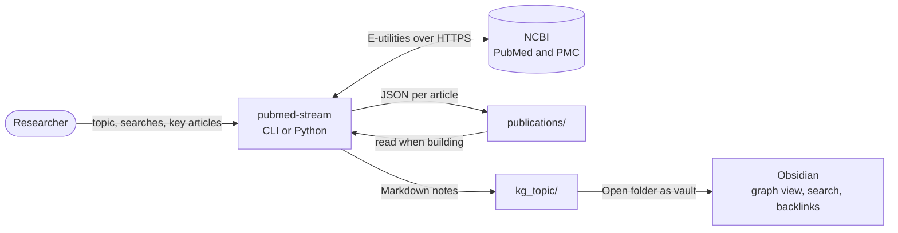

The only runtime dependency is `requests`. Everything else, including the XML parsing, the YAML frontmatter and the Markdown rendering, uses the Python standard library.

---

## 2. Repository map

```
pubmed-stream/
├── pubmed_stream/
│   ├── __init__.py        public API: everything importable from pubmed_stream
│   ├── __main__.py        python -m pubmed_stream
│   ├── cli.py             argparse front end: download, neighborhood, kg
│   ├── downloader.py      E-utilities client, PMC search and download, JATS parsing
│   ├── neighborhood.py    similar, citing and cited articles of a PubMed article
│   ├── vault.py           Obsidian notes: graph model, merging, rendering, safe rewrites
│   └── kg.py              studies: topic, searches and seeds, refresh
├── tests/                 86 offline tests; NCBI is faked with canned responses
├── examples/              kg_tutorial.ipynb, kg_study.py, keyword lists, utilities
└── docs/                  this guide and its figures
```

| Module | Lines | Responsibility | Main public functions |
|--------|------:|----------------|-----------------------|
| `downloader.py` | 1001 | HTTP client with rate limiting and retries; PMC search; full-text download; metadata, reference and text extraction from JATS XML | `search_and_download`, `esearch_pmc`, `efetch_pmc`, `extract_metadata_from_pmc_xml` |
| `neighborhood.py` | 457 | ELink relations, PubMed records with flags and MeSH terms, flag counts beyond the cap | `get_neighborhood`, `save_neighborhood`, `download_neighborhood` |
| `vault.py` | 981 | Merges every source into one graph of papers, concepts and collections, then writes notes without losing user edits | `build_vault`, `topic_vault_dir` |
| `kg.py` | 247 | The study layer: runs searches and seeds, records them, refreshes them | `create_kg`, `load_study`, `record_study` |
| `cli.py` | 453 | Parses arguments and maps them onto the functions above; sets exit codes | `main` |

The modules form a strict stack. Each one imports only from the modules below it, so the download layer never knows about vaults, and the vault never calls the CLI:

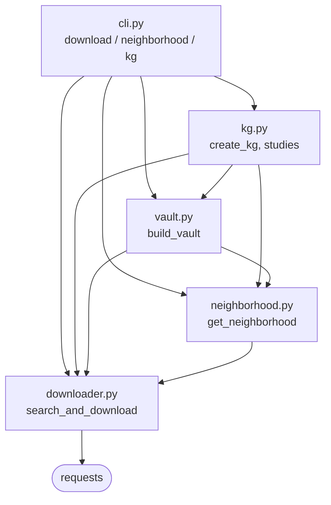

---

## 3. Talking to NCBI

Every request goes through one of two paths in `downloader.py`. Both share a thread-safe `RateLimiter`, so concurrent downloads never exceed NCBI's limits.

| Endpoint | Database | Used for | Called by |
|----------|----------|----------|-----------|
| `esearch.fcgi` | `pmc` | Find PMC articles for a search, up to `max_results` | `esearch_pmc` |
| `efetch.fcgi` | `pmc` | Full-text JATS XML, one article per request | `efetch_pmc` |
| `elink.fcgi` | `pubmed` | Similar, citing and cited articles, in one call with `cmd=neighbor_score` | `get_neighborhood` |
| `efetch.fcgi` | `pubmed` | PubMed records: titles, publication types, grants, MeSH terms; 200 PMIDs per request | `get_neighborhood`, `build_vault` |
| `epost.fcgi` + `esearch.fcgi` | `pubmed` | Count reviews, retractions, NIH funding and PMC coverage across links beyond the cap | `get_neighborhood` |

| Setting | Value | Why |
|---------|-------|-----|
| Requests per second | 10 with `NCBI_API_KEY`, 3 without | NCBI's published limits; detected automatically |
| Retries | 3 attempts, waiting 2 s, then 4 s | Rides out rate-limit replies (HTTP 429) and network blips |
| Timeout | 60 s per request | Large full-text articles |
| Download threads | 5 by default, `--workers` to change | Full text is fetched one article per request |
| API key in logs | Always redacted | Error messages from `requests` contain the full URL |

The shared request helper is short enough to read in full. This is its core:

```python
for attempt in range(retries):
    try:
        rate_limiter.wait()                      # shared across threads
        resp = session.get(url, params=params, timeout=REQUEST_TIMEOUT)
        resp.raise_for_status()
        return resp
    except requests.RequestException as e:
        error = _redact_api_key(e)               # never log the API key
        logger.warning("%s attempt %d/%d failed: %s", endpoint, attempt + 1, retries, error)
        if attempt < retries - 1:
            time.sleep(RETRY_DELAY * (attempt + 1))
raise requests.RequestException(f"{endpoint} failed: {error}")
```

---

## 4. Downloading full text

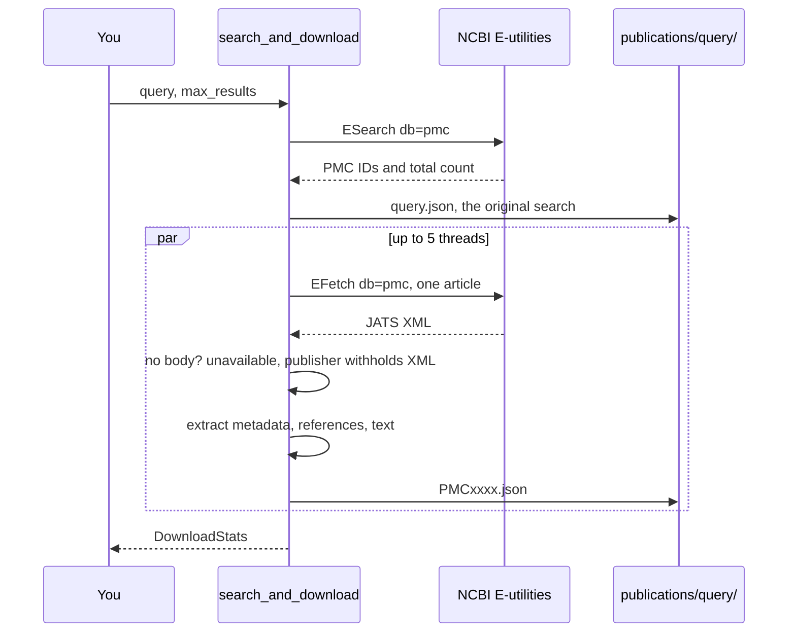

Re-running a search skips files that already exist, so a refresh only downloads new articles. Each article becomes one JSON file:

```json
{
  "pmcid": "PMC13279599",
  "source": "PMC",
  "download_date": "2026-10-18T13:20:45",
  "metadata": {
    "pmid": "42060019",
    "doi": "10.1007/s40520-026-03403-6",
    "title": "Association between gut microbiota and sarcopenia in older adults: ...",
    "journal": "Aging Clinical and Experimental Research",
    "year": "2026",
    "authors": ["Ramezani Kashal Fatemeh", "..."],
    "abstract": "Introduction Investigating gut microbiota has emerged ...",
    "keywords": ["Sarcopenia", "Gut microbiota", "Aging", "Muscle metabolism"],
    "references": [
      {"pmid": "32033882", "title": "Asian Working Group for Sarcopenia: 2019 Consensus Update ...", "year": "2020"}
    ]
  },
  "text": "Introduction\nInvestigating gut microbiota ..."
}
```

| Extracted from the JATS XML | Field | Notes |
|-----------------------------|-------|-------|
| Article IDs | `pmid`, `pmcid`, `doi` | From `article-id` elements |
| Title, journal, dates | `title`, `journal`, `year`, `month`, `day` | Electronic publication date preferred |
| Authors | `authors` | "Surname Given names" |
| Abstract and keywords | `abstract`, `keywords` | All abstract sections joined |
| Reference list | `references` | Cited works with a PMID or DOI; these become citation links in the knowledge graph |
| Body text | `text` | Title, abstract and body, one paragraph per line; omitted with `--exclude-text` |

---

## 5. Evidence neighborhoods

A neighborhood is the programmatic counterpart of NLM's Linked Discoveries page for one article. It costs two requests for up to 200 articles, plus five more for each relation that `max_per_relation` cuts short.

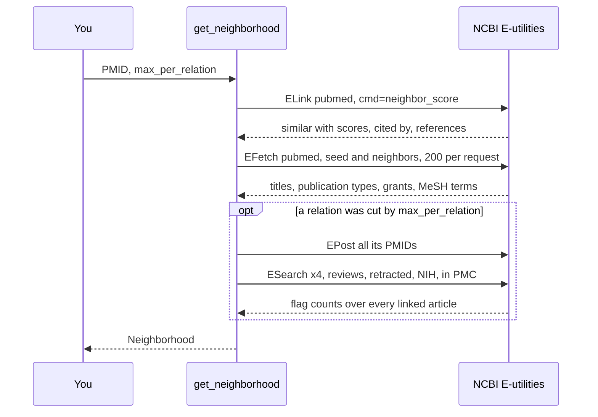

| Flag on each article | How it is decided |
|----------------------|-------------------|
| `is_review` | Publication type is Review, Systematic Review or Scoping Review |
| `is_retracted` | Publication type Retracted Publication, or a RetractionIn notice |
| `nih_funded` | An N.I.H. support publication type, or a grant whose agency names NIH |
| `pmcid` | The article has a PMC ID, so its full text may be downloadable |
| `mesh_terms` | MeSH descriptors, each with its ID and a major-topic flag |

---

## 6. Knowledge graphs

### 6.1 A study from start to finish

`create_kg` is the study layer. It runs what is new, or everything with `refresh=True`, then hands the folders to `build_vault`:

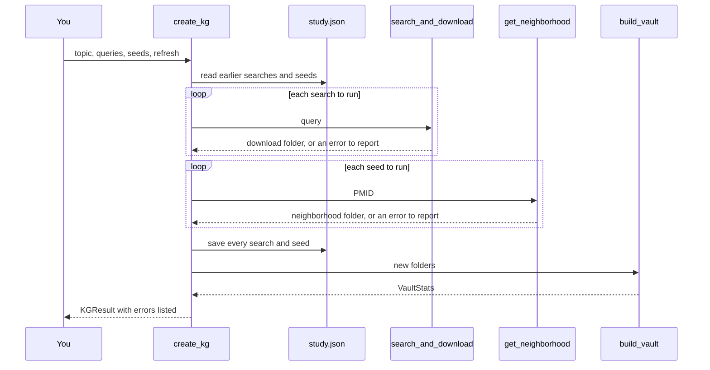

A failed search or seed never stops the study. It is listed in `KGResult.errors`, kept in `study.json` so a refresh retries it, and the graph is built from everything else.

### 6.2 How notes are built

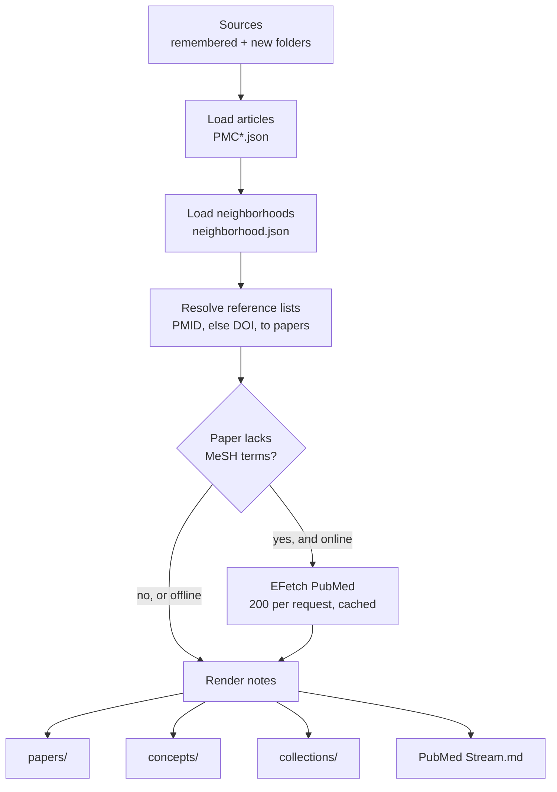

Papers from different sources are merged into one record, so a paper found by two searches and one neighborhood still has one note.

| Rule | Behaviour |
|------|-----------|
| Identity | A paper is matched by PMID, then PMC ID, then DOI. Its note is named `PMID<id>`, or by PMC ID when there is no PMID |
| First known value wins | Full-text metadata loads first, so PMC titles and abstracts win over PubMed summaries |
| Flags | Review, retracted and NIH-funded are OR-ed across sources |
| Full text | A paper becomes full text when any source downloaded it; otherwise it is a stub |
| Notes | Only papers with a known title, or with full text, get a note; others stay as unresolved links |
| Concepts | Every MeSH heading becomes a concept note, except check tags such as Humans, Male or Aged |
| Citations | Reference-list entries with a PMID, plus neighborhood cites and cited-by links. DOI-only references are listed but not linked |

### 6.3 Safe rebuilds

Users write in these notes, so a rebuild must never destroy their work. Each note has a generated block between two markers, and the tool owns a fixed list of frontmatter keys:

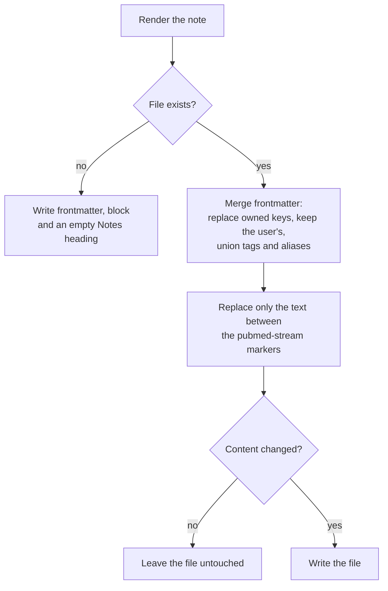

| Part of a note | Owned by | On rebuild |
|----------------|----------|------------|
| Owned frontmatter keys, such as `title`, `pmid`, `mesh` and `status` | pubmed-stream | Replaced |
| `tags` and `aliases` | Both | The tool's `pubmed/...` tags are replaced; the user's entries are kept |
| Any other frontmatter key | The user | Kept as written |
| Text between `%% pubmed-stream:start %%` and `%% pubmed-stream:end %%` | pubmed-stream | Replaced |
| Everything else, such as the `## Notes` section | The user | Kept as written |

### 6.4 On disk

```
publications/                                 downloads, shared by every study
├── gut_microbiota_Title_AND_frailty_Title_Abstract/
│   ├── query.json                            the original search
│   └── PMC13279599.json ...
└── neighborhood_31319564/
    └── neighborhood.json
kg_gut_microbiome_frailty/                    one study = one Obsidian vault
├── PubMed Stream.md                          home note
├── papers/PMID42060019.md ...                one note per paper
├── concepts/Sarcopenia.md ...                one note per MeSH heading
├── collections/Search - ... .md              one note per search or neighborhood
├── .obsidian/graph.json                      graph-view colour groups, first build only
└── .pubmed-stream/
    ├── study.json                            topic, searches, seeds
    ├── sources.json                          download folders the graph is built from
    └── pubmed_records.json                   cached PubMed records with MeSH terms
```

---

## 7. The example study in figures

The figures below are drawn from the notes of the study in [`examples/kg_study.py`](../examples/kg_study.py): two searches on the gut microbiome with frailty and with sarcopenia, plus the neighborhood of a 2019 review, PMID 31319564. [`docs/figures/make_figures.py`](figures/make_figures.py) regenerates them from any knowledge graph.

| Part of the graph | Count |
|-------------------|------:|
| Papers with full text, from the two searches | 42 |
| Stub papers, from the seed's neighborhood | 85 |
| MeSH concept notes | 309 |
| Collections | 3 |
| Citation links between papers in the graph | 115 |
| Similar-article links between papers in the graph | 30 |
| Notes in total, with the home note | 440 |

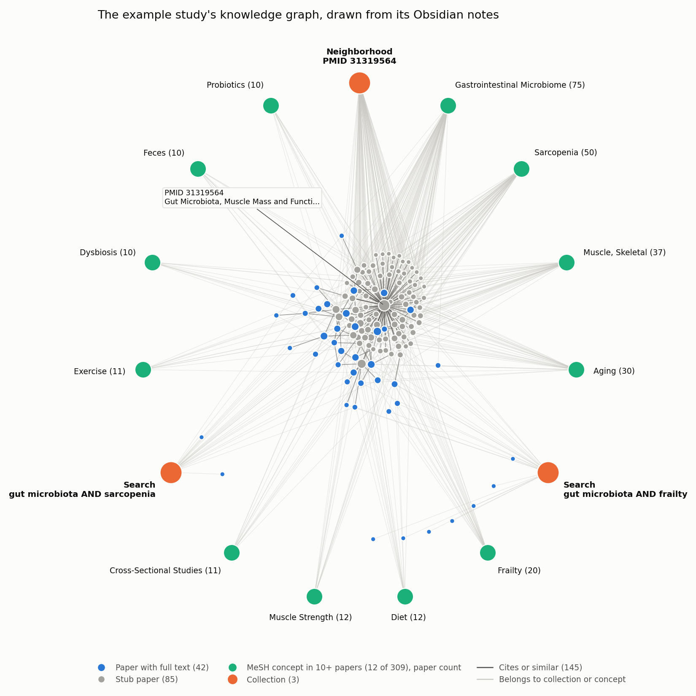

*The knowledge graph as a network.* The seed review sits at the center, ringed by its neighborhood of stub papers. Papers from the two searches attach to it through citations. Twelve MeSH concepts, those linked by ten or more papers, sit on the outer ring with the three collections. Papers with no citation inside the graph stay close to the search that found them. Obsidian's graph view shows the same structure, interactively.

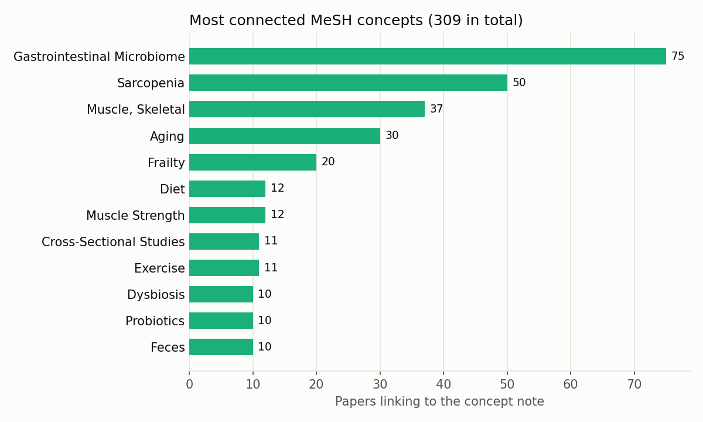

*The concepts that tie the study together.* Gastrointestinal Microbiome links 75 papers and Sarcopenia 50. These hubs are where papers from different searches meet.

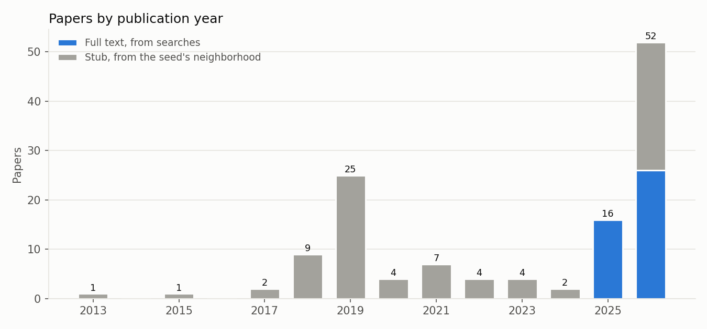

*Searches and neighborhoods complement each other.* The full-text papers from the searches are all from 2025 and 2026, because PMC returns the newest matches first. The seed's neighborhood adds the older literature, peaking in 2019, the seed's own year, through the papers it cites and those PubMed rates as similar.

| Year | 2013 | 2015 | 2017 | 2018 | 2019 | 2020 | 2021 | 2022 | 2023 | 2024 | 2025 | 2026 |
|------|-----:|-----:|-----:|-----:|-----:|-----:|-----:|-----:|-----:|-----:|-----:|-----:|
| Full text | 0 | 0 | 0 | 0 | 0 | 0 | 0 | 0 | 0 | 0 | 16 | 26 |
| Stub | 1 | 1 | 2 | 9 | 25 | 4 | 7 | 4 | 4 | 2 | 0 | 26 |

---

## 8. Data model

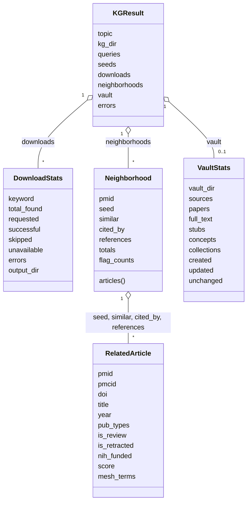

| Class | Returned by | Meaning |
|-------|-------------|---------|
| `DownloadStats` | `search_and_download`, `download_neighborhood` | One download run: found, requested, saved, skipped, unavailable |
| `RelatedArticle` | inside `Neighborhood` | One PubMed article with its flags and MeSH terms |
| `Neighborhood` | `get_neighborhood` | A seed and its three relations, with uncapped totals and flag counts |
| `VaultStats` | `build_vault` | One build of the notes: counts of papers, concepts and changed files |
| `KGResult` | `create_kg` | One run of a study: what ran, what failed, and the build |

---

## 9. Testing

All tests run offline in about two seconds. NCBI is replaced by a fake HTTP adapter that answers by URL, so tests exercise the real request and parsing code:

```python
session = make_session(routes={
    "esearch.fcgi?db=pmc": search_json(["1"]),     # a PMC search finding one article
    "efetch.fcgi?db=pmc": full_xml,                # its JATS full text
    "elink.fcgi": elink_json,                      # a neighborhood
    "efetch.fcgi?db=pubmed": pubmed_xml,           # PubMed records with MeSH terms
})
result = create_kg("gut microbiome study", queries=["gut microbiome"], seeds=["100"],
                   session=session, rate_limit=0, offline=True)
```

| Test file | Tests | Covers |
|-----------|------:|--------|
| `test_parsing.py` | 13 | JATS metadata, dates, references and text extraction |
| `test_download.py` | 10 | Search, download, skipping, unavailable articles, API key redaction, query files |
| `test_neighborhood.py` | 24 | Relations, flags, MeSH terms, capped counts, saving, CLI |
| `test_vault.py` | 25 | Citation links, stubs, concepts, escaping, safe rebuilds, sources, MeSH cache, naming |
| `test_kg.py` | 14 | Studies, refresh, failure reporting, validation, CLI |

```bash
pip install -e ".[dev]"
pytest
```

---

## 10. Extending pubmed-stream

| To add | Change | Keep in mind |
|--------|--------|--------------|
| A new field from the full text | `extract_metadata_from_pmc_xml` in `downloader.py` | Old downloads lack it; read it with a fallback |
| A new flag on neighbors | `_parse_pubmed_article`, and `_FLAG_FILTERS` for uncapped counts, in `neighborhood.py` | Add the matching PubMed search filter |
| A new link type in the graph | `_Graph` loading and `_render_paper` in `vault.py` | Links must point at note names, such as `PMID123` |
| A new note type, such as authors | A renderer and its owned keys in `vault.py` | Add its keys to an owned-keys tuple, or rebuilds will treat them as the user's |
| A Logseq or other output format | A second renderer over the same `_Graph` | The graph model is format-independent; only rendering is Obsidian-specific |
| A new study option | `create_kg` in `kg.py`, then the `kg` parser in `cli.py` | Record anything a refresh must repeat in `study.json` |
