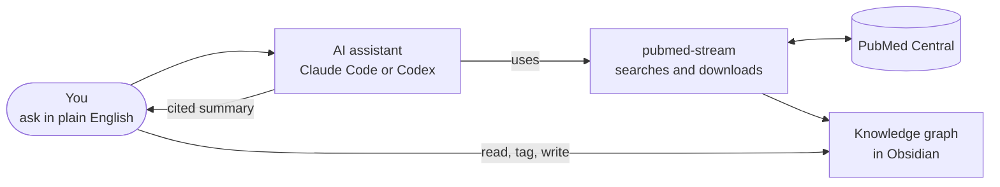
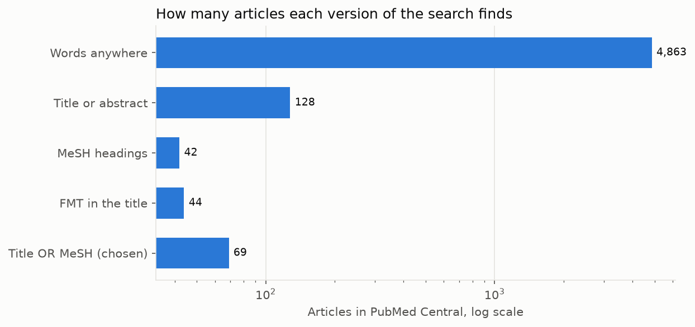
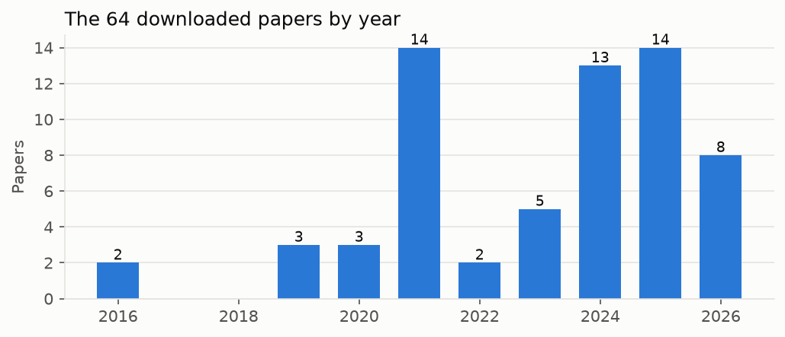
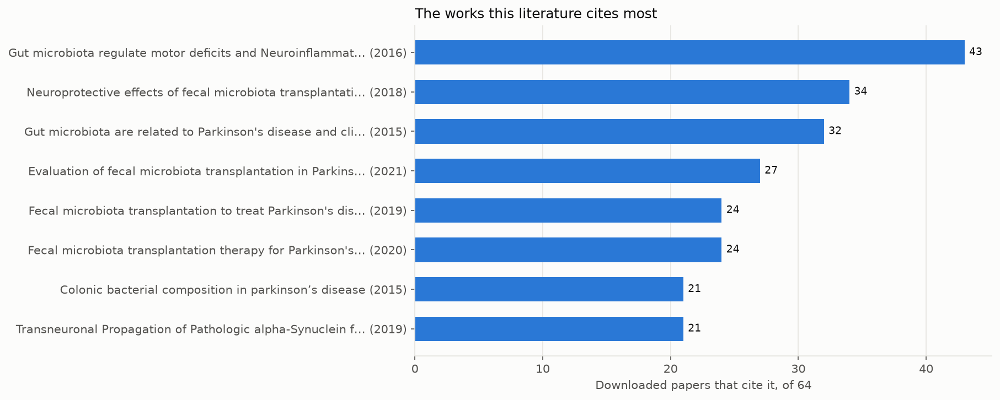
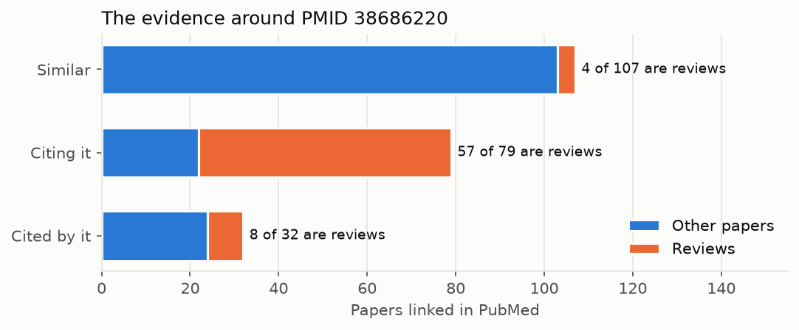
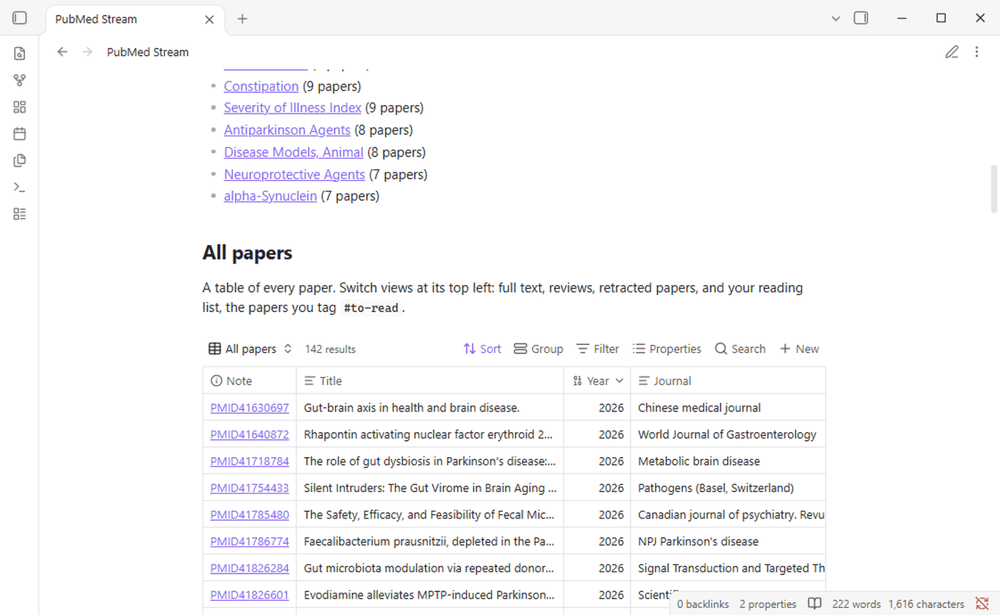
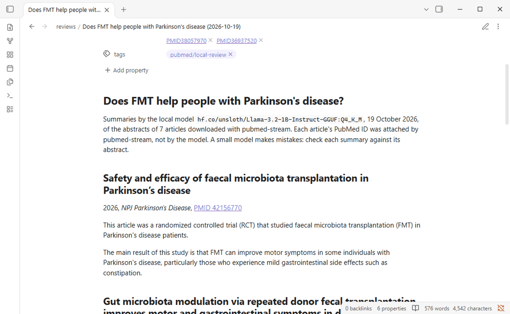

# Tutorial 7: Your literature search with an AI assistant

**A step-by-step guide for medical students and biologists who have never programmed.**

You will set up an AI assistant that searches PubMed Central for you, downloads the papers, reads their abstracts and writes a summary in which every statement cites a paper you can check. Everything it finds is kept in a knowledge graph you can browse in Obsidian. If your question must stay private, a model running on your own computer can do the reading instead.

You type questions in plain English. You never write code.

| | |
|---|---|
| **Time** | About an hour to install everything once; then 10 to 30 minutes per question |
| **Cost** | pubmed-stream, Obsidian and Ollama are free. Claude Code needs a paid Claude plan (Pro or higher); Codex needs a paid ChatGPT plan (Plus or higher). Ask whether your school provides one. |
| **You need** | A Windows, Mac or Linux computer and an internet connection |

**Contents**

1. [Before you start: the tools in plain words](#1-before-you-start-the-tools-in-plain-words)
2. [Install everything](#2-install-everything)
3. [Connect your assistant to pubmed-stream](#3-connect-your-assistant-to-pubmed-stream)
4. [Choose a model](#4-choose-a-model)
5. [Ask your first question](#5-ask-your-first-question)
6. [Check the work like a scientist](#6-check-the-work-like-a-scientist)
7. [Keep it in Obsidian](#7-keep-it-in-obsidian)
8. [Private questions: a model on your own computer](#8-private-questions-a-model-on-your-own-computer)
9. [Recipes for medical school](#9-recipes-for-medical-school)
10. [When something goes wrong](#10-when-something-goes-wrong)
11. [Reference](#11-reference)

> [!IMPORTANT]
> **Three rules before you begin**
> - **Never type patient information** into Claude Code or Codex: no names, record numbers, dates of birth or other details that could identify a person. They send what you type to a company's servers. Follow your school's and hospital's data policies.
> - **This is for learning and research, not for treating patients.** A summary of papers is not a clinical guideline.
> - **You are the author.** Check the papers yourself before you use a claim, and follow your school's rules on disclosing AI use.

---

## 1. Before you start: the tools in plain words

| Tool | What it is | Why you need it |
|---|---|---|
| **Terminal** | A window where you type commands instead of clicking. *Terminal* or *PowerShell* on Windows, *Terminal* on a Mac. | Everything below starts from it. You will type a handful of commands, always copied from this tutorial. |
| **pubmed-stream** | A free program that searches PubMed Central, downloads full-text papers and builds a knowledge graph of them. | It gives the assistant real papers to read, so it does not cite from memory. |
| **An AI assistant** | **Claude Code** (by Anthropic) or **Codex** (by OpenAI): an AI that works in your terminal and can use programs such as pubmed-stream. | It designs the searches, reads the abstracts and writes the summary. You only need one of the two. |
| **A model** | The AI "brain" the assistant runs on. Each assistant offers several, faster or more capable. | [Section 4](#4-choose-a-model) explains how to choose. |
| **Obsidian** | A free note-taking app that shows linked notes as a map. | You browse, tag and write notes on the papers there. |
| **Ollama** | A free program that runs a small AI model on your own computer. | Optional, for questions that must stay private. |

**Which assistant?** Both work the same way with pubmed-stream. Pick the one whose paid plan you already have, or that your school provides: Claude Code with a Claude plan, Codex with a ChatGPT plan.

How they fit together:



---

## 2. Install everything

Do these steps once, in order. After each one, a check tells you whether it worked. If a check fails, see [section 10](#10-when-something-goes-wrong).

### 2.1 Open a terminal

- **Windows:** press the Windows key, type `PowerShell`, and press Enter.
- **Mac:** press Cmd+Space, type `Terminal`, and press Enter.

A window opens with a line ending in `>` (Windows) or `%` (Mac). That is where you type. To run a command, copy it from this page, paste it with a right-click (Windows) or Cmd+V (Mac), and press Enter.

### 2.2 Install Python and pubmed-stream

Follow steps 1 and 2 of [how to run the tutorials](guides/setup.md#option-2-your-own-computer) to install Python, then install pubmed-stream:

```bash
python -m pip install --upgrade pubmed-stream
```

On a Mac, type `python3` instead of `python`, here and below. The command prints many lines and ends with `Successfully installed`.

> **Check:** `pubmed-stream --version` prints 0.4.2 or later.

### 2.3 Install your assistant

Install **one** of the two.

**Claude Code.** Run the line for your system:

```bash
# Windows (PowerShell)
irm https://claude.ai/install.ps1 | iex

# Mac or Linux
curl -fsSL https://claude.ai/install.sh | bash
```

The installer shows no progress while it downloads. When it finishes, **close the terminal and open a new one**, then type `claude`. The first time, it opens your web browser to sign in; use an account with a Pro, Max, Team or Enterprise plan, because the free plan does not include Claude Code. Type `/exit` to leave.

> **Check:** `claude --version` prints a version number.

**Codex.** Run the line for your system:

```bash
# Windows (PowerShell)
powershell -ExecutionPolicy ByPass -c "irm https://chatgpt.com/codex/install.ps1 | iex"

# Mac or Linux
curl -fsSL https://chatgpt.com/codex/install.sh | sh
```

Open a new terminal and type `codex`. The first time, choose **Sign in with ChatGPT**, with a Plus, Pro, Business, Edu or Enterprise plan. Type `/quit` to leave.

> **Check:** `codex --version` prints a version number.

These commands come from the official instructions: [Claude Code setup](https://code.claude.com/docs/en/setup) and [Codex](https://github.com/openai/codex). Check there if anything has changed.

### 2.4 Install Obsidian

Download it from [obsidian.md](https://obsidian.md) and install it like any other app. The [Obsidian guide](guides/obsidian.md) shows how to use it.

### 2.5 Optional: Ollama, for private questions

Only needed for [section 8](#8-private-questions-a-model-on-your-own-computer). Download Ollama from [ollama.com](https://ollama.com) and install it, or on Windows run `winget install Ollama.Ollama`. Then download a small model, 807 MB:

```bash
ollama pull hf.co/unsloth/Llama-3.2-1B-Instruct-GGUF:Q4_K_M
```

> **Check:** `ollama list` shows the model.

### 2.6 Optional: a free NCBI API key

It makes searches and downloads about three times faster. [Get one in five minutes](guides/setup.md#getting-a-free-ncbi-api-key) and keep it at hand: `pubmed-stream init` asks for it in section 3, checks it with NCBI and saves it for every folder. To add it later, run `pubmed-stream init --ncbi-api-key YOUR-KEY` in your research folder.

---

## 3. Connect your assistant to pubmed-stream

There are two ways. **Option A** prepares one folder, which is all most people need: use one folder per question, so that everything the assistant downloads and writes for it stays together. **Option B** installs pubmed-stream as a plugin of Claude Code or Codex once, so that the assistant has it in every folder you open. You can also do both: `init` notices the plugin and does not connect a folder twice.

### Option A: one folder per question

1. **Create an empty folder** where you keep your work, for example `Documents/fmt-parkinson`.
2. **Open a terminal in that folder.** In the terminal, type `cd` and a space, then drag the folder from your file explorer onto the terminal window, which fills in its location, and press Enter.
3. **Prepare the folder** for the assistants:

   ```bash
   pubmed-stream init
   ```

   The first time, it asks for your NCBI API key ([section 2.6](#26-optional-a-free-ncbi-api-key)): paste it, or press Enter to skip; it asks only once. Then you should see:

   ```
    created  AGENTS.md
    created  CLAUDE.md
    created  GEMINI.md
    created  .mcp.json
    created  .codex\config.toml
    created  .gemini\settings.json
   ```

   `AGENTS.md` holds the rules the assistant follows: search before downloading, cite only papers it read, say what it could not read. The other files connect the assistant to pubmed-stream. You do not need to open any of them.
4. **Start your assistant** in the same terminal: `claude` or `codex`.
5. **Answer its first questions.** Claude Code asks whether you trust this folder and whether to use the *pubmed-stream* server: answer yes. Codex may ask whether to trust the folder: answer yes.

> **Check:** Type `/mcp`. You should see *pubmed-stream* with its tools, such as `search_pmc` and `download`.

Next time, open a terminal in the same folder and type `claude` or `codex` again; everything is still there.

### Option B: the plugin, once for every folder

The plugin gives Claude Code or Codex pubmed-stream's tools and rules wherever you start it. It fetches pubmed-stream by itself through a small program called **uv**, so install uv first:

```bash
# Windows (PowerShell)
powershell -ExecutionPolicy ByPass -c "irm https://astral.sh/uv/install.ps1 | iex"

# Mac or Linux
curl -LsSf https://astral.sh/uv/install.sh | sh
```

Open a new terminal, then install the plugin for your assistant:

- **Claude Code:** run `claude plugin install pubmed-stream --marketplace melhzy/pubmed-stream`. It asks for your NCBI API key ([section 2.6](#26-optional-a-free-ncbi-api-key)): paste it, or leave it empty and add it later by typing `/plugin configure pubmed-stream@pubmed-stream` inside Claude Code. The first time the plugin runs, it also saves the key for the command line, so `init` will not ask for it.
- **Codex:** run `codex plugin marketplace add melhzy/pubmed-stream`, start `codex`, type `/plugins`, open *pubmed-stream* and choose *Install plugin*; then quit Codex and start it again. Codex has no place to type the key, so save it once by running `pubmed-stream init --ncbi-api-key YOUR-KEY` in your research folder.

Then create a folder for your question, open a terminal in it as in option A, and start `claude` or `codex`.

> **Check:** Type `/mcp`. You should see *pubmed-stream* with its tools. In Claude Code, the rules come as the skill `pubmed-stream:literature-search`.

---

## 4. Choose a model

Each assistant offers several models. More capable models reason better but are slower and use up more of your plan's allowance; faster ones suit simple tasks. pubmed-stream works the same with any of them.

**Our advice:** for literature work, use your assistant's recommended or most capable model. Reading papers and judging evidence is exactly where the bigger models make fewer mistakes. Use a faster model for simple chores, such as counting search results.

### Claude Code

| To | Do this |
|---|---|
| Switch during a session | Type `/model` and choose from the list |
| Start a session with a model | `claude --model opus` (or `sonnet`, `haiku`) |
| Make it this folder's default | `pubmed-stream init --claude-model opus` |

The names `opus`, `sonnet` and `haiku` always mean the latest model of that family. `/model` shows which ones your plan includes.

### Codex

| To | Do this |
|---|---|
| Switch during a session | Type `/model` and choose a model and how hard it should think |
| Start a session with a model | `codex -m <model name>`, with a name from `/model` |
| Make it your default everywhere | Put `model = "<model name>"` on the first line of the `config.toml` file in the `.codex` folder of your home folder |

Codex 0.163 ignores a model setting inside a research folder, so pubmed-stream does not write one; use `/model` or `-m`.

### The local model for private questions

| To | Do this |
|---|---|
| Use another model once | `pubmed-stream review "..." --model llama3.2:3b` |
| Use Claude Code, Codex or Gemini CLI instead | `pubmed-stream review "..." --model claude` (or `codex`, `gemini`): more accurate, but the abstracts leave your computer |
| Make it this folder's default | `pubmed-stream init --review-model llama3.2:3b` |
| See and get models | `ollama list` shows what you have; `ollama pull llama3.2:3b` downloads one |

Larger local models summarize better but need more memory: a 1-billion-parameter model runs on almost any laptop, while models of 7 billion or more want a recent computer with plenty of memory or a graphics card. The [README](../README.md#5-work-with-ai-assistants-local-models-and-obsidian) suggests models for each size of computer.

---

## 5. Ask your first question

Type your question as you would ask a colleague, and say what you want back. A good first question names the topic, the kind of evidence, and the output:

> *Does fecal microbiota transplantation (FMT) help people with Parkinson's disease? Find the clinical evidence and summarize it, with PMIDs. Show me the search counts before you download anything.*

### What happens next

The assistant works in steps and tells you what it is doing. When it wants to download files or build the knowledge graph, it may ask your permission: read what it plans, and approve. Searching and reading need no approval.

This is what happened when we asked that question on 18 October 2026, step by step.

**Step 1. It tested the search before downloading.** A plain search matched 4,863 articles, mostly about other things, because PubMed Central searches the full text, including reference lists. The assistant narrowed it down, checking the newest titles each time:

| Search | Articles | Newest titles |
|---|---:|---|
| `"fecal microbiota transplantation" AND parkinson` | 4,863 | Off topic |
| FMT in title or abstract, and Parkinson in title or abstract | 128 | Mostly on topic |
| The MeSH headings for FMT and Parkinson disease | 42 | On topic, but misses the newest papers |
| FMT in the **title**, Parkinson in title or abstract | 44 | All on topic |
| The title search **or** the MeSH search | 69 | Chosen |

*MeSH* headings are the standard subject terms PubMed's indexers give each paper; see the [glossary](guides/glossary.md).



The scale is logarithmic: each grid line is ten times the one before, so the loose search is about 70 times larger than the one chosen. The chosen search is larger than the title search because it adds, with *OR*, the papers PubMed indexes under the MeSH headings.

**Step 2. It downloaded the 69 articles.** 64 were saved; 5 publishers do not allow downloading. One of those 5 was a 2024 randomized trial in *JAMA Neurology*, which the assistant noted it could not read.



Most downloaded papers are recent. That is partly the field growing, and partly how searches work: PubMed Central returns the newest matches first, and older papers are often not available as full text. The older work still shows up through what the new papers cite.

**Step 3. It read compactly.** It listed the 64 titles, found which papers the field cites most (a 2016 mouse study in *Cell*, cited by 43 of the 64), then read the abstracts of the trials and meta-analyses.



The most cited works are the field's foundations: the first evidence in mice and patients, and the first case reports and small studies of transplants in Parkinson's disease. Reading the top two or three first gives you the vocabulary of the field.

**Step 4. It checked the key trial for retractions.** None of the papers linked to the GUT-PARFECT trial was retracted. Of the 79 papers citing it, 57 are reviews: the field has far more commentary than new trials.



**Step 5. It saved the study** as a knowledge graph of 142 papers, `kg_fmt_parkinson`, ready for Obsidian.

**Step 6. It wrote the report:**

> **Does FMT help people with Parkinson's disease?** Possibly for constipation; for motor symptoms, the controlled evidence is small and mixed.
>
> **Randomized, placebo-controlled trials**
> - GUT-PARFECT, 46 patients with early Parkinson's disease, one nasojejunal transplant of donor stool or the patient's own stool: after 12 months the motor score (MDS-UPDRS, off medication) improved by 5.8 points with donor stool and 2.7 points with placebo (p = 0.0235). Side effects were temporary abdominal discomfort (PMID 38686220).
> - 72 patients not yet taking Parkinson's medication, repeated donor or own-stool transplants: at 35 weeks the motor score (UPDRS III) changed by −3.8 versus +0.1, and constipation improved more with donor stool. Adverse events were mild (PMID 41826284).
> - 56 patients, oral transplants or placebo: the transplant group improved more in total MDS-UPDRS score and in gastrointestinal symptoms, without severe adverse events (PMID 38057970).
> - A pilot of 12 patients with constipation, oral capsules or placebo for 12 weeks: constipation and gut motility improved, but objective motor improvement was only temporary (PMID 36937520).
>
> **Studies without a control group** (11, 15 and 5 patients) report improvements in motor and non-motor symptoms and constipation (PMIDs 33985520, 32871960, 41466105). Without placebo groups, they cannot separate the treatment from a placebo effect.
>
> **Syntheses disagree.** A meta-analysis of 3 randomized trials, 145 patients, found no difference from placebo on any part of the MDS-UPDRS, and more gastrointestinal adverse events with FMT (PMID 41113141). A meta-analysis of all gut-targeted treatments, including antibiotics, probiotics and synbiotics as well as FMT, found a modest motor improvement and less constipation, but it does not isolate FMT (PMID 41078360). A 2026 review of 5 randomized trials and 6 other studies, 236 people, found that constipation improved consistently while motor results were heterogeneous: improvements came mainly from uncontrolled studies, and changes in most trials were close to the minimal clinically important difference (PMID 42156770).
>
> **Why results differ.** The trials used different donors, preparations and routes (nasojejunal tube, oral capsules), single or repeated doses, and different patients (early disease, untreated patients, patients with constipation).
>
> **Not covered.** A 2024 randomized trial in *JAMA Neurology* (PMID 39073834) could not be downloaded; read it on PubMed before drawing conclusions. Mouse studies in the corpus were not used for clinical claims.
>
> **Searches**, run on 18 October 2026: the five versions above, from 4,863 to 69 articles; the final one downloaded 64 full texts.

Every statement comes from an abstract the assistant read, and each PMID opens at `https://pubmed.ncbi.nlm.nih.gov/<PMID>/`.

We also gave both assistants other questions. Claude Code, asked to summarize the newest randomized trial among ten papers, found that the trial could not be downloaded and refused to summarize it from memory. Codex, asked which works the field cites most, downloaded and read them, and pointed out that the landmark paper showed its effect in mice, not patients.

### Chart your own session

The charts in this section come from the session's own files, drawn by a small script, [`session_figures.py`](tools/session_figures.py). To chart your own session, download it into your research folder once, with the chart library it needs (on Windows, type `curl.exe`):

```bash
python -m pip install matplotlib
curl -o session_figures.py https://raw.githubusercontent.com/melhzy/pubmed-stream/main/tutorials/tools/session_figures.py
```

Then, after the assistant has downloaded papers and built a knowledge graph, run:

```bash
python session_figures.py
```

It saves charts of the papers by year, the most cited works, the kinds of evidence and the key paper's neighborhood in a `figures` folder, which you can open like any pictures. To chart your searches too, list them in a text file, one `label | search` per line, and add `--searches searches.txt`. Or simply ask your assistant: *"Run session_figures.py on this folder and describe the charts."*

### Keep the conversation going

The assistant remembers the conversation, so follow up:

- *Which of these trials had the longest follow-up?*
- *Quote the sentence in PMID 41113141 that gives the adverse events.*
- *Search for trials of FMT in multiple system atrophy too, and add them to the knowledge graph.*

---

## 6. Check the work like a scientist

The rules prevent invented citations, but an assistant can still misread a paper. Before you use a claim in an essay, a presentation or your own research:

1. **Open the papers behind the claims you will use.** Click through to `https://pubmed.ncbi.nlm.nih.gov/<PMID>/` and check that the abstract says what the summary says. You can ask: *"Quote the sentence you relied on."*
2. **Check the kind of evidence.** Ask yourself where each paper sits:

   | Evidence | What it can show |
   |---|---|
   | Systematic review or meta-analysis of randomized trials | The strongest summary of whether a treatment works, if the trials are good |
   | Randomized controlled trial | Whether a treatment works, in the patients studied |
   | Cohort, case-control or cross-sectional study | Associations; not cause and effect |
   | Case series or uncontrolled study | Ideas worth testing; cannot rule out placebo effects |
   | Animal or cell study | Mechanisms; not effects in patients |
   | Narrative review | Expert overview; useful for orientation, not as evidence |

   In the session above, PubMed's labels sort the 64 downloaded papers like this:

   

   Half are narrative reviews, and only 2 are labelled randomized controlled trials, although the report discusses 4. The other two trials, GUT-PARFECT among them, have no labels at all: they appeared in journals outside MEDLINE, PubMed's curated core, so PubMed never gives them publication types or MeSH headings. Very new papers lack them too, for weeks to months. Labels are a guide; the abstract tells you what a study really is.

3. **Read the "not covered" part.** pubmed-stream downloads only papers that publishers allow, newest first; important older or paywalled papers may be missing.
4. **Look at the searches.** Do the counts and sample titles make sense? Would you have searched differently?
5. **Ask for the other side:** *"Which papers in the corpus disagree with this?"*

For a formal systematic review, use the assistant only for scoping and search design; see [what pubmed-stream can and cannot do](guides/limitations.md).

---

## 7. Keep it in Obsidian

The knowledge graph is where your reading continues. Ask the assistant to build one (*"Build a knowledge graph of this study"*), then open it:

1. **The first time,** open Obsidian, choose **Open folder as vault**, and select the `kg_<topic>` folder, such as `kg_fmt_parkinson`.
2. **After that,** `pubmed-stream open kg_fmt_parkinson` opens it from the terminal.

The home note has a table of every paper. Switch views at its top left: all papers, full texts, reviews, retracted papers, and your reading list.



Make it yours:

- **Tag papers to read** with `#to-read` anywhere in their note; they appear in the *Reading list* view.
- **Write your notes** under each paper, below the line that ends the generated part; they are kept when the graph is updated.
- **Keep it current:** ask *"Refresh the knowledge graph and tell me what is new."*

With Obsidian's [command line](https://obsidian.md/help/cli) switched on (**Settings > General**), the assistant can read the open graph too: *"Which papers have I tagged to read?"* or *"Which notes mention butyrate?"* The [Obsidian guide](guides/obsidian.md) covers the graph view, search and much more.

---

## 8. Private questions: a model on your own computer

For an unpublished idea, or anything you would rather not send to a company, Ollama runs a model on your own computer: nothing leaves it except the PubMed searches themselves.

**Know its limits.** A small model cannot be the assistant: we asked a 1-billion-parameter model to run a single search through Codex, and it never ran it, misread the command, and described pubmed-stream as "a Google CLI tool". It can, however, summarize abstracts you chose. So you, or a cloud assistant on a non-private part of the work, collect the papers, and the local model reads them.

1. Collect the papers in your folder, with the assistant or by hand: `pubmed-stream download '<search>'`.
2. Choose the papers to read: `pubmed-stream list publications` shows them, one per line.
3. Ask the local model:

   ```bash
   pubmed-stream review "Does FMT help people with Parkinson's disease?" --id 38686220 41826284 38057970 36937520 41113141 41078360 42156770 --vault kg_fmt_parkinson
   ```

It summarizes each paper separately and prints the summaries. pubmed-stream, not the model, attaches each PubMed ID, so a summary is never credited to the wrong paper, and it flags any number in a summary that the abstract does not contain. `--vault` also saves the review as a note in your knowledge graph:



The model sees only one abstract at a time, never your question: given the question, small models tend to open with it restated as a finding ("The gut microbiota is linked to frailty.") even when the paper did not test it.

**How well did it do?** On the seven papers above, six of seven summaries were usually accurate, with the details copied correctly. The one at the top of the picture is the exception: it calls a review of eleven studies a randomized controlled trial and muddles its result. Run again straight away, the model gives the same summaries, but after Ollama reloads the model they can change, and with a model this small so can their accuracy: in one run three of the seven were wrong, one saying the treatments improved cognitive function when the paper found they did not. With `--answer`, the model also writes one answer from all the summaries, but at this size that answer is unreliable: it invented contradictions and credited findings to the wrong papers. Use the summaries as a fast first reading, check them against the abstracts, and draw conclusions yourself.

On a laptop with a graphics card, seven papers took 5 to 12 seconds; without one, allow a few seconds to a minute per paper. [Section 4](#4-choose-a-model) shows how to use a larger model.

---

## 9. Recipes for medical school

Copy, adapt and paste these into your assistant.

| Task | Ask |
|---|---|
| **Prepare a journal club** | *Find the randomized trial PMID 38686220 and the papers that cite it. Summarize what later studies added or disputed, and list three questions for discussion.* |
| **Answer a question from a case** | *In adults with Clostridioides difficile infection that keeps coming back, what is the trial evidence for FMT compared with antibiotics? Show the searches first.* (No patient details.) |
| **Start a research proposal** | *What is known about the oral microbiome in Alzheimer's disease, and which questions have no human studies yet? Build a knowledge graph I can explore.* |
| **Understand a mechanism** | *What do animal studies show about how gut bacteria could affect alpha-synuclein? Separate mouse findings from human findings.* |
| **Check a claim you heard** | *A lecture said probiotics prevent sarcopenia in older adults. What do the randomized trials show?* |
| **Find the classics** | *Which papers does the literature on frailty and the gut microbiome cite most? Give me the five to read first and why.* |
| **Stay current** | *Refresh my knowledge graph and summarize the papers that are new since last month.* |
| **Read one paper deeply** | *In PMID 41826284, find how stool was prepared and how often it was given.* |

Tips:

- **Be specific** about the population, the intervention, the comparison and the outcome you care about.
- **Ask to see the searches first** when you want to steer.
- **Ask for evidence types** in the answer: trials, cohorts, animal studies.
- **Start a new folder** for each new question, so each knowledge graph stays focused.

---

## 10. When something goes wrong

| Problem | What to do |
|---|---|
| `pubmed-stream`, `claude` or `codex` is "not recognized" or "not found" | Close the terminal and open a new one. If it persists, repeat the install step for that tool. |
| The assistant says it has no pubmed-stream tools | Make sure you started it in the folder where you ran `pubmed-stream init`. In Claude Code, `/mcp` shows the server; approve it if asked. With the plugin, uv is probably missing: repeat the first step of [option B](#option-b-the-plugin-once-for-every-folder) and open a new terminal. |
| The assistant asks permission to run something | Read what it wants to do. Downloads and knowledge graphs are expected; approve them. |
| A search finds thousands of papers | Ask the assistant to put the main topic in the title, or to use MeSH headings. |
| A paper the assistant mentions can't be found | Ask which search it came from. If its PMID is not among the downloads, do not rely on the claim. |
| `Ollama is not running` | Start Ollama from its icon, and try again. |

The [troubleshooting guide](guides/troubleshooting.md) covers many more cases, and the [glossary](guides/glossary.md) explains the terms.

---

## 11. Reference

For readers who want to know what happens behind the scenes, or to use pubmed-stream without an assistant.

### What the assistant uses

`pubmed-stream init` connects the assistant to pubmed-stream through **MCP**, the Model Context Protocol, an open standard by which assistants call tools directly. These are the tools, with the matching commands you can type yourself:

| Command | MCP tool | What it does |
|---|---|---|
| `pubmed-stream search QUERY --show 10` | `search_pmc` | Counts a search and lists its newest matches, without downloading |
| `pubmed-stream download QUERY --max-results N --quiet` | `download` | Downloads the full texts into `publications/<search>/` |
| `pubmed-stream abstracts QUERY --max-results N --quiet` | `fetch_abstracts` | Saves the PubMed abstracts of papers whose full text is not free, in the same folder |
| `pubmed-stream list publications` | `list_articles` | One line per downloaded paper, newest first |
| `pubmed-stream list publications --id PMID ... --abstracts` | `list_articles` | The abstracts of chosen papers |
| `pubmed-stream list publications --cited` | `most_cited` | The works the downloaded papers cite most |
| `pubmed-stream export publications -o review.bib` | `export_citations` | Citations for Zotero, EndNote or Mendeley, as BibTeX or RIS |
| | `read_article` | Searches inside one paper's full text |
| `pubmed-stream neighborhood PMID --quiet` | `neighborhood` | Similar, citing and cited papers of one paper, with retraction flags |
| `pubmed-stream kg TOPIC -q QUERY --seed PMID --quiet` | `build_knowledge_graph` | Builds or updates a knowledge graph; `--refresh` adds new papers |
| `pubmed-stream review QUESTION --id PMID ...` | | Summaries by a local model through Ollama, with checks |
| `pubmed-stream open kg_TOPIC` | | Opens a knowledge graph in Obsidian |
| `pubmed-stream init` | | Prepares a folder for Claude Code, Codex and Gemini CLI |

### The files `init` writes

| File | Read by | Contains |
|---|---|---|
| `AGENTS.md` | Codex; imported by the others | The rules: size searches first, cite only papers read, name what is missing |
| `CLAUDE.md`, `GEMINI.md` | Claude Code, Gemini CLI | One line that imports `AGENTS.md` |
| `.mcp.json` | Claude Code | How to start pubmed-stream's tools |
| `.codex/config.toml` | Codex | The same, for Codex |
| `.claude/settings.json` | Claude Code | The folder's model, with `--claude-model` |
| `.pubmed-stream.json` | `pubmed-stream review` | The folder's local model, with `--review-model` |
| `~/.pubmed-stream.json`, in your home folder | pubmed-stream, in every folder | Your NCBI API key, with `--ncbi-api-key`, or typed when `init` asks for it |

Running `init` again never overwrites your changes. [Option B](#option-b-the-plugin-once-for-every-folder) of section 3 installs pubmed-stream as a plugin instead; with the plugin installed, `init` leaves the server out of the folder, so the tools are not listed twice.

### Obsidian's command line

With Obsidian running and its command line switched on, these work on an open knowledge graph:

```bash
obsidian vault=kg_fmt_parkinson search query=butyrate path=papers total
obsidian vault=kg_fmt_parkinson backlinks file=PMID38686220 total
obsidian vault=kg_fmt_parkinson base:query path=Papers.base view="Reading list" format=paths
```

On the session's graph, they answered 18 papers mentioning butyrate, 75 notes linking to the GUT-PARFECT trial, and the one paper tagged to read.

### Using the local model directly

For a single abstract, Ollama's own command line is enough:

```bash
pubmed-stream list publications --id 38686220 --abstracts | ollama run hf.co/unsloth/Llama-3.2-1B-Instruct-GGUF:Q4_K_M --nowordwrap "Summarize the clinical finding of this article in two sentences."
```

Give it one or a few abstracts at a time: `ollama run` gives this model a working memory of 4,096 tokens, roughly 3,000 words, and silently drops whatever does not fit. `pubmed-stream review` asks for 8,192 and warns when a prompt fills it.

### Exit codes

The commands exit with 0 on success, 1 when nothing was found, and 2 on network or download errors, so an assistant can tell what happened without reading the output.
