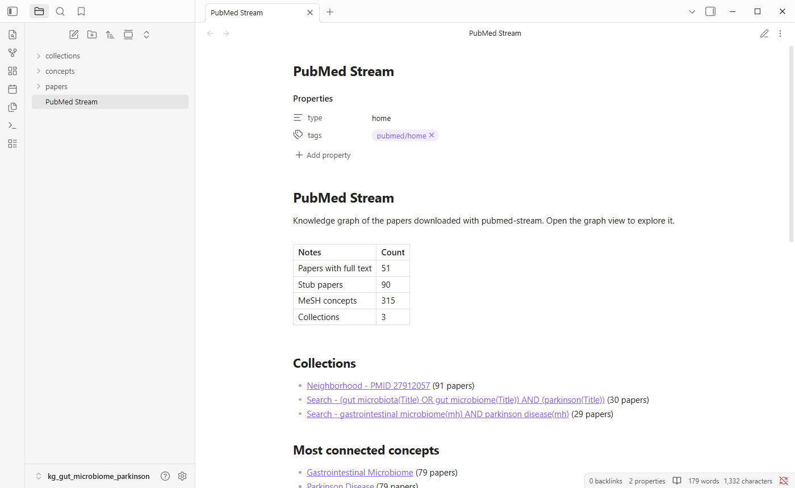
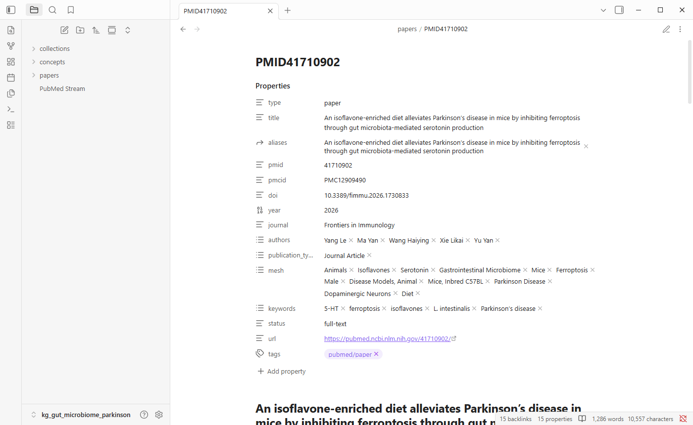
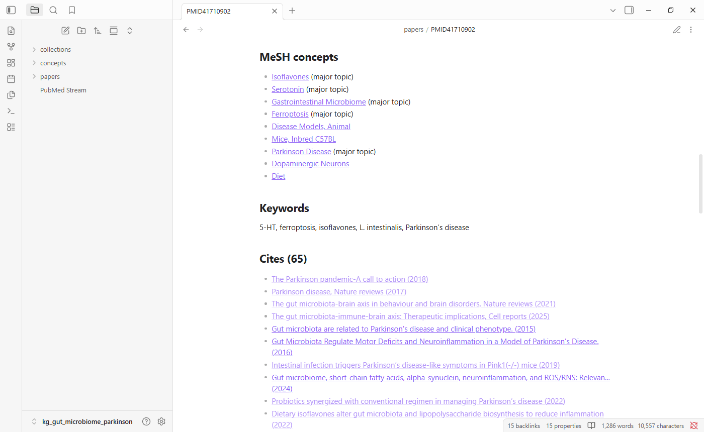
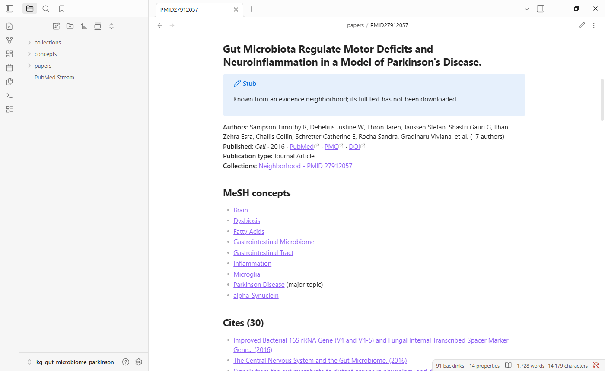
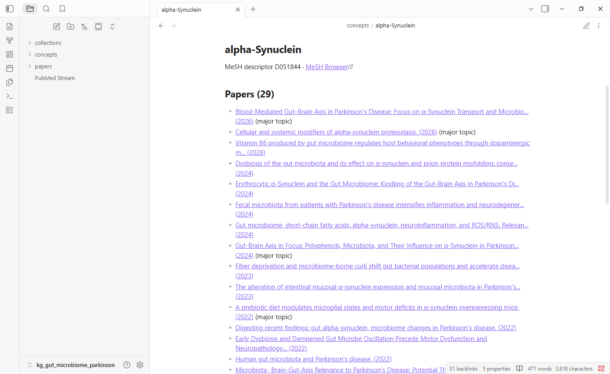
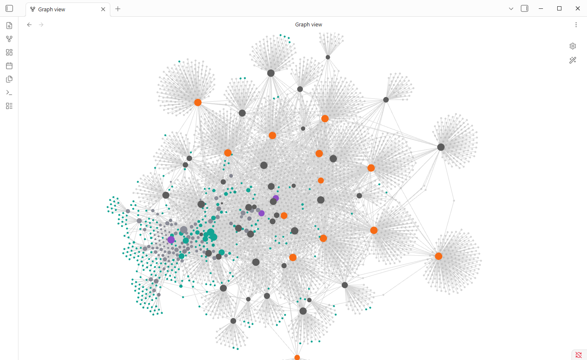
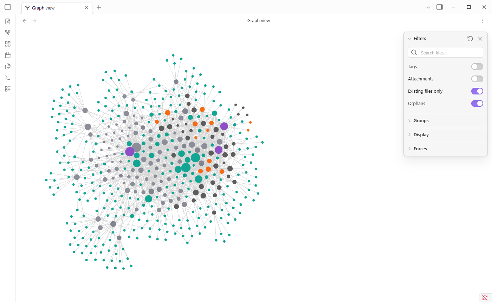
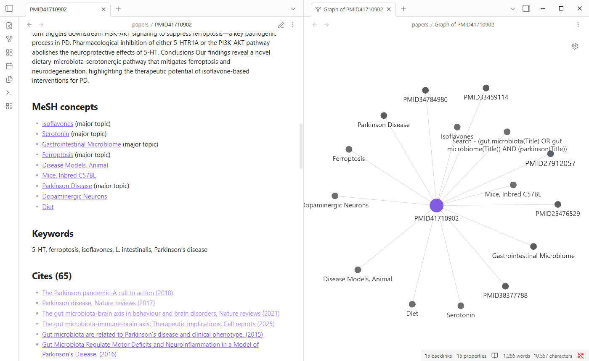
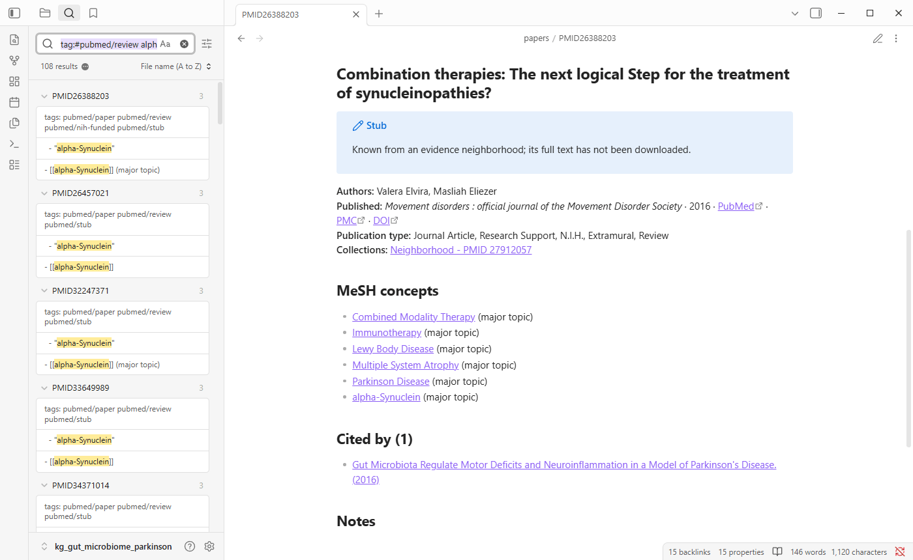
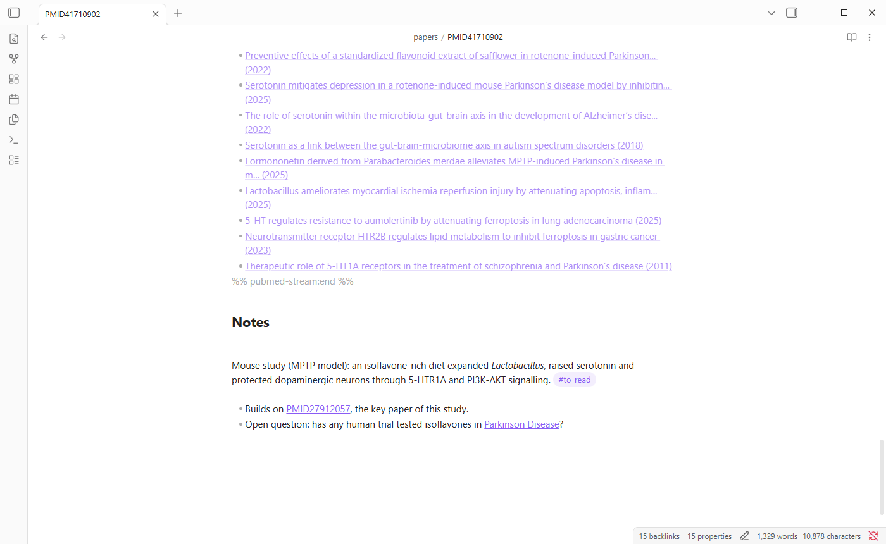

# Reading a knowledge graph in Obsidian

pubmed-stream builds a knowledge graph as a folder of linked notes, `kg_<topic>`. [Obsidian](https://obsidian.md) is a free note-taking app that turns such a folder into a browsable, searchable map of your study, where you can also write your own notes. This guide shows how to open the graph, find your way around it, and make it your own. The screenshots show the graph that [tutorial 0](../00_new_topic.ipynb) builds, on the gut microbiome in Parkinson's disease.

- [Install Obsidian and open the graph](#install-obsidian-and-open-the-graph)
- [The home note](#the-home-note)
- [Paper, concept and collection notes](#paper-concept-and-collection-notes)
- [The graph view](#the-graph-view)
- [One paper's neighborhood: the local graph](#one-papers-neighborhood-the-local-graph)
- [Search](#search)
- [Write your own notes](#write-your-own-notes)
- [Keep the graph current](#keep-the-graph-current)

## Install Obsidian and open the graph

1. Download Obsidian from [obsidian.md](https://obsidian.md) for Windows, Mac or Linux, and install it. It is free, and your notes stay on your computer.
2. Find the graph's folder. The tutorials print where it is, such as `tutorials/workspace/kg_gut_microbiome_frailty`. In Google Colab, the last cell saves it as a zip file: unzip it first.
3. Start Obsidian and choose **Open folder as vault**. On later visits, choose **Open another vault** from the vault menu at the bottom left.
4. Select the `kg_<topic>` folder itself, the one that holds `PubMed Stream.md` and the `papers`, `concepts` and `collections` folders, and click **Open**.

Obsidian calls a folder of notes a **vault**. Your knowledge graph is now one.

## The home note

Open **PubMed Stream** in the file list on the left. It is the graph's front page: how many papers and concepts it holds, a link to each collection, and the most connected concepts. Click any link to follow it.



Links work like a web page: click to open, and Ctrl+click (Cmd+click on a Mac) to open in a new tab. The arrows at the top left go back and forward.

## Paper, concept and collection notes

The graph has three kinds of notes, in three folders.

**Papers** (`papers/PMID<number>`) have one note each. At the top, **properties** list the paper's details: title, PubMed ID, DOI, year, journal, authors, publication types and MeSH headings. Below them:

- **Authors, journal and links** to PubMed, PMC and the publisher.
- **Abstract** and the authors' **keywords**, for downloaded papers. The full text itself stays in the downloaded JSON files, which the other tutorials analyse.
- **MeSH concepts**, each a link to its concept note, marked *(major topic)* when it is a main point of the paper.
- **Cites**, **Cited by** and **Similar articles**: links to other papers in the graph.



Further down, the links connect the paper to the rest of the graph. Links in full colour lead to notes; the paler ones are explained below.



A note that starts with a **Stub** box is a paper from a key paper's evidence neighborhood that was not downloaded. It has PubMed's details and links, but no abstract or full text.



A cited paper that is neither downloaded nor in a neighborhood has no note. Its link is a placeholder: Obsidian shows it in a paler colour, and clicking it creates an empty note. Its PubMed ID is in the link, so you can look it up.

**Concepts** (`concepts/`) have one note per MeSH heading, listing every paper indexed with it. Open one to see every paper in your study about that concept, with the ones where it is a major topic marked.



**Collections** (`collections/`) have one note per search or evidence neighborhood, listing the papers it brought in and its top concepts.

## The graph view

Open it with the **graph icon** in the left toolbar, or with Ctrl+G (Cmd+G on a Mac). Every note is a dot and every link a line. Hover over a dot to highlight its links and see its name; click it to open the note. Scroll to zoom, and drag the background to move around.



At first the graph is crowded. Each burst of small pale dots is a downloaded paper and the papers it cites that have no note. Switch them off with **Existing files only**, under **Filters** in the settings panel, which opens from the gear at the top right. What remains is your study's structure:



Here the key paper's neighborhood, mostly stubs, forms the cluster on the left, and the papers the searches downloaded, with their reviews, the cluster on the right. Shared MeSH concepts tie the two together.

The dots have colours:

| Colour | Notes |
|---|---|
| Red | Retracted papers |
| Purple | Collections: your searches and neighborhoods |
| Teal | MeSH concepts |
| Light grey | Stub papers |
| Orange | Reviews |
| Dark grey, Obsidian's default | Other downloaded papers |
| Small pale dots | Cited papers without a note |

A paper that matches several rows takes the first, so a retracted review is red. To change the colours, expand **Groups** in the settings panel.

**Filters** can also narrow the graph down. Type into its search box:

| Filter | Shows |
|---|---|
| `path:papers` | Papers only, linked by citation and similarity |
| `-path:concepts` | Everything except concepts |
| `tag:#pubmed/review` | Reviews only |
| `-tag:#pubmed/stub` | Downloaded papers, collections and concepts, without stubs |

Under **Display**, *Arrows* shows which paper cites which, and *Node size* makes well-connected notes bigger. Dragging the *Forces* sliders spreads a crowded graph out.

**What to look for:** tight clusters of papers are sub-topics; a concept dot with many lines is a central theme; a paper that sits between two clusters links two lines of research and is worth reading early.

## One paper's neighborhood: the local graph

The full graph shows everything. The **local graph** shows only what links to one note, which is the best way to explore a single paper or concept.

Open a paper note, press Ctrl+P (Cmd+P) to open the command palette, type `local graph`, and choose **Graph view: Open local graph**. It opens beside the note and follows you as you move between notes. In its settings, **Depth** sets how many links away it reaches: 1 shows direct neighbors, 2 their neighbors too. Switch on **Existing files only** here as well, so that only notes are shown.



The local graph has its own settings, so it does not use the full graph's colours. Add the same groups under **Groups** if you want them.

The **Backlinks** panel in the right sidebar lists every note that links to the open one. On a concept note, that is every paper about the concept; on a paper, every paper that cites it.

## Search

Press Ctrl+Shift+F (Cmd+Shift+F) to search every note. Plain words search titles, abstracts and your own notes. Each result shows the matching lines; click one to open the note.



Some useful searches, which can be combined, such as `tag:#pubmed/review alpha-synuclein`:

| Search | Finds |
|---|---|
| `butyrate` | Every note that mentions butyrate |
| `path:papers butyrate` | Papers that mention it |
| `tag:#pubmed/retracted` | Retracted papers |
| `tag:#pubmed/review` | Reviews |
| `tag:#pubmed/nih-funded` | NIH-funded papers |
| `[year:2024]` | Papers published in 2024 |
| `[status:full-text]` | Papers whose full text was downloaded |
| `"Randomized Controlled Trial"` | Papers of that publication type |

Properties can also be shown as a sortable table, with the core **Bases** plugin in recent versions of Obsidian, or with the community **Dataview** plugin.

## Write your own notes

The graph is meant to be written in. Each generated note has a block between two lines that start `%% pubmed-stream:start` and `%% pubmed-stream:end`. These lines are hidden in reading view. pubmed-stream rewrites only what is inside the block, so:

- **Write below the end line.** Summaries, critiques, quotes and ideas there are kept when the graph is rebuilt.
- **Link as you write.** Type `[[` and start typing a paper's title, a PubMed ID such as `PMID31319564`, or a concept such as `Sarcopenia`, and Obsidian suggests the note. Your links appear in the graph view too.
- **Tag papers for yourself**, for example `#to-read`, `#key-paper` or `#method`, anywhere in the note.
- **Add your own properties**, such as `reading: done` or `rating: 4`. Use names the tool does not use; it owns `type`, `title`, `aliases`, `pmid`, `pmcid`, `doi`, `year`, `journal`, `authors`, `publication_types`, `mesh`, `keywords`, `status`, `retracted`, `url` and `tags`. Tags and aliases you add are kept.
- **Create notes of your own**, such as a synthesis note or a draft introduction, anywhere in the vault, linking to the papers they discuss.

In editing view, the end line is visible, and everything you write below it is yours:



Do not rename or move the generated notes: a rebuild would recreate them under their original names. Edits inside the generated block are overwritten.

## Keep the graph current

New papers appear every week. Run the same notebook again, or from the command line:

```bash
pubmed-stream kg "gut microbiome frailty" --refresh
```

This reruns the study's searches and key papers, downloads only what is new, and updates the notes. Obsidian shows the changes immediately, and your own writing stays where it was.
